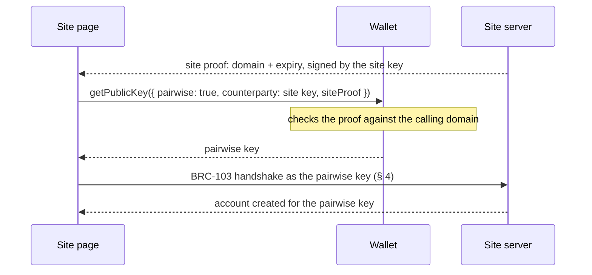
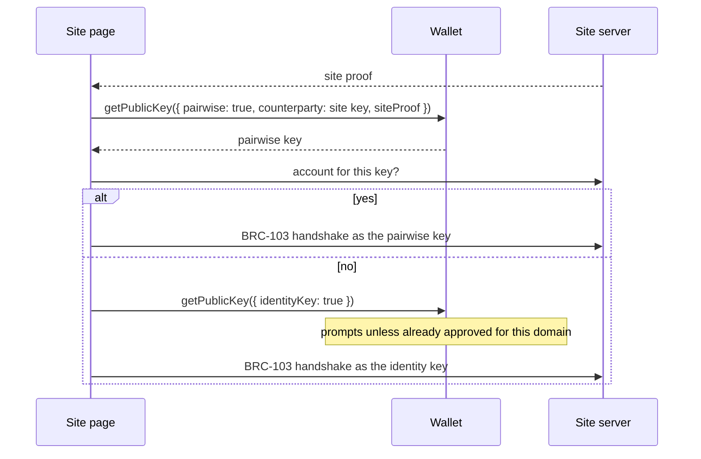
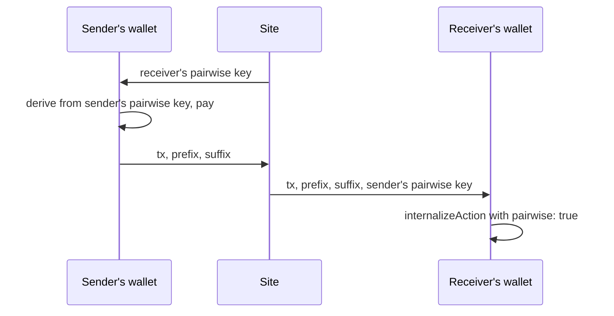

# BRC-182: Pairwise Authentication

Matthew Archbold (matthew.archbold@marstonenterprises.com), Marston Enterprises

## Abstract

A [BRC-100](../wallet/0100.md) (Unified, Vendor-Neutral, Unchanging, and Open BSV Blockchain Standard
Wallet-to-Application Interface) wallet authenticates to every site with the same **identity key**, its master public key.
Any two sites that hold it can tell they have the same user, and the user can't take it back or clear
it.

This document specifies **pairwise authentication**: the wallet authenticates to each site with a
key derived from the user's master key, **that site's public key and the domain the wallet is
called from**. The key is stable at one site, so the user can create an account and log back in. It
differs at every other site, so sites can't use it to link the user. It uses existing
[BRC-42](../key-derivation/0042.md) (BSV Key Derivation Scheme (BKDS)) derivation, the existing
[BRC-103](./0103.md) (Peer-to-Peer Mutual Authentication and Certificate Exchange Protocol) message
format, the existing [BRC-105](../payments/0105.md) (HTTP Service Monetization Framework) payment
headers and [BRC-77](./0077.md) (Message Signature Creation and Verification) signatures. What it adds
is one wallet-interface flag, a reserved derivation, a signed statement in which the site vouches
for its domain before the wallet answers, and the rules a wallet follows to keep sites from
choosing the user's key for them.

## Where this fits: three ways a wallet presents a user

A wallet can present a user to a site with one of three keys. They escalate from most private to least:

| | Session key | Pairwise key | Identity key |
|---|---|---|---|
| Wallet call | `getPublicKey({ session: true })` | `getPublicKey({ pairwise: true, counterparty: <site key>, siteProof })` | `getPublicKey({ identityKey: true })` |
| Same key on | One visit to one site | Every visit to one site | Every site |
| Who can link the user by this key | No one | That site, across visits | Anyone who sees it |
| Site signs for its domain first | SHOULD | MUST | SHOULD |
| Wallet prompt | None needed | SHOULD, at least the first time at each site | MUST |
| Specified in | BRC-XXX (Ephemeral Session Keys) | This document | BRC-100, BRC-103 |

The methods that carry the key are the same in every mode: the BRC-103 handshake, BRC-105 payments and
other payment protocols take whichever key the wallet returns. This document specifies the middle
mode: one key per site, so a user can hold an account at a site without becoming linkable anywhere
else.

## Motivation

### The identity key is the same at every site

BRC-100 calls the master public key the **identity key**. BRC-103 authenticates a peer by the key in its `identityKey` field, and the reference SDK fills that field
with `getPublicKey({ identityKey: true })`. So a user who logs in to twenty sites gives each of them
the same permanent identifier.

The registry already says this should change, and already names the principle:

> *"Ordinary authentication should use an application-specific derived key. That identifier should
> be unique to the defined application context, separate from payment keys, replaceable if the
> relationship ends and unusable for discovering the user across unrelated services."*
> [BRC-151](../opinions/0151.md) (BRC-100 Risk Assessment and Best Integration Practices)

> *"An application domain is not automatically an extra cryptographic separator simply because the
> wallet knows which application made the request."* and *"The enduring principle is contextual
> identity."* [BRC-191](../opinions/0191.md) (Thoughts on Identity, Privacy and Recovery on the
> Metanet)

No BRC specifies how a wallet does it. This document does.

### Why the site's key and the calling domain

The pairwise key is derived from the user's master key with the site's **public key** and the
**calling domain** in the key ID (§ 1). The counterparty is `self`, so only the user's wallet can
compute it: the site's key and domain select which key the user gets, and take no part in the shared
secret. The site's key is how BRC-103 already identifies the site. The calling domain is what the
browser reports, which the page can't set.

Both are needed because a site's public key is public. If the key ID held the site key alone, a page
on `evil123.com` could present `abc.com`'s site key and receive the user's `abc.com` pairwise key,
before `abc.com` had proved anything and even if the user had never visited it. With the calling
domain in the key ID, that page receives a key that exists only for `evil123.com` with `abc.com`'s
site key, which no `abc.com` account will ever hold. OpenID Connect Core 1.0 § 8.1 keys pairwise
identifiers on the host of the site's registered address in the same way, and WebAuthn scopes each
credential to the site's domain (its RP ID).

### The site signs for its domain first

A site is the public party: it invites users in, so it identifies itself first. TLS follows the same
order: the server presents its certificate before the client identifies itself, if it ever does
(RFC 8446 § 2). Before the wallet returns a pairwise key, the site gives it a signature, made with the
site key, over the site's own domain (§ 2.3). The signature is the site's own; no third party is
involved. The wallet checks the signed domain against the calling domain, which the browser reports.
The user's side discloses nothing until the site has done this.

The two rules do different work. The site's signature proves that the holder of the site key vouches
for this domain. The calling domain in the key ID means that a page which got past a missing or faulty
check would still receive a key that is useless anywhere else.

A signature over a random challenge alone would not be enough: `evil123.com`'s server could pass the
challenge to `abc.com`, receive `abc.com`'s signature and hand it back. A signature that names
`abc.com` fails the wallet's check on `evil123.com`, and `evil123.com` can't change the name without
breaking the signature.

## Terminology

The key words MUST, MUST NOT, SHOULD, SHOULD NOT and MAY are to be interpreted as described in
RFC 2119.

- **Identity key**: the wallet's master public key, as defined in BRC-100. The same at every site.
- **Pairwise**: one value per pair of parties, so that no third party can link the values used with
  different counterparties. The term follows OpenID Connect Core 1.0 § 8, which defines `public` and
  `pairwise` subject identifiers. In product copy the same idea is often called *site-scoped*.
- **Site key**: the public key a site authenticates with in BRC-103. It belongs to the site.
- **Pairwise key**: the user's key for one site, derived as in § 1. It belongs to the user.
- **Calling domain**: the domain the wallet attributes a request to. BRC-100 calls this the
  `originator`. Wallets reached by a web page take it from the browser (for example the `Origin`
  header), which the page cannot set. Where this document puts the calling domain into a key ID or a
  signed message, it is written as the host name in lowercase ASCII, with internationalised names in
  their A-label (punycode) form, with no scheme, path or trailing dot, followed by `:` and the port
  only when the port is not the default for the scheme. `https://Shop.Example.com/` is
  `shop.example.com`.
- **Site proof**: a [BRC-77](./0077.md) signature by the site key, verifiable by anyone, over the
  site's domain and an expiry time (§ 2.3).

## Specification

### 1. Deriving the pairwise key

The pairwise key is the BRC-42 child of the user's master key with:

| Input | Value |
|---|---|
| Counterparty | `self` |
| Invoice number | `2-admin pairwise-<site key> <calling domain> <version>` |

- The invoice follows [BRC-43](../key-derivation/0043.md) (Security Levels, Protocol IDs, Key IDs and
  Counterparties): security level `2`, protocol ID `admin pairwise`, and a key ID made of the site key
  (33-byte compressed, lowercase hex), one space, the calling domain in the form given under
  Terminology, one space, and a version number in decimal. For `example.com`, version `1` gives
  `2-admin pairwise-<site key> example.com 1`.
- **The calling domain is in the key ID** so that a page can't obtain the user's key for another
  site by presenting that site's key (Motivation). The wallet MUST take it from the browser, never
  from the page or from an argument of the call. Two wallets restoring the same master key compute the
  same pairwise keys only if they write the calling domain identically, so the form under Terminology
  is normative.
- **The counterparty is `self`, not the site key.** BRC-42 is symmetric: a key derived from the user's
  private key and the site's public key can also be computed from the site's private key and the
  user's public key. With the site key as counterparty, a site could take any identity key it knows,
  compute what that user's pairwise key would be, and compare it with the key it was shown, unmasking
  the user without any help from another site. With `self`, the shared secret comes from the user's
  private key alone. The site key in the key ID still makes the key different at every site.
- The protocol ID starts with `admin`, which [BRC-44](../key-derivation/0044.md) (Admin-reserved and
  Prohibited Key Derivation Protocols) reserves for the wallet's own use. A wallet MUST refuse any
  application request that names a protocol ID beginning with `admin`, at every security level. Only
  the wallet derives the pairwise key, and only through the `pairwise` flag in § 2. Without this rule,
  an application could request the pairwise key for any other site and link the user.
- The version gives a user more than one account at a site. A wallet MAY offer a fresh, unconnected
  account at the same site by using version `2`, `3` and so on. This document uses `1` throughout.
- Wallets MUST NOT store the pairwise key. It is re-derived on every use.

### 2. The `pairwise` flag

This document adds one optional boolean argument, `pairwise`, to the BRC-100 methods that take a
`protocolID`, `keyID` and `counterparty` (`getPublicKey`, `encrypt`, `decrypt`, `createHmac`,
`verifyHmac`, `createSignature`, `verifySignature`) and to each payment output of
`internalizeAction`.

`pairwise: true` means: **perform this operation starting from the pairwise key for the calling
domain and its recorded site key, instead of from the master key.** Every other argument keeps its
BRC-100 meaning.

#### 2.1 Recording the site key

- The first call with `pairwise: true` from a calling domain MUST be a `getPublicKey` that supplies
  `counterparty` as the site key and a valid site proof (§ 2.3). The wallet records the pair (calling
  domain, site key).
- Every later call with `pairwise: true` from that domain uses the recorded site key. The application
  MAY supply `counterparty`, but it does not change which pairwise key is used.
- If a `getPublicKey` call supplies a site key that differs from the one recorded for the domain, the
  wallet MUST NOT silently replace it. It SHOULD show the user that the site's key has changed, and
  MUST NOT proceed without the user's approval.
- If a different calling domain supplies a site key already recorded for another domain, the wallet
  MAY tell the user. Because the calling domain is in the key ID, the two domains receive different
  pairwise keys, so a shared site key doesn't link the user.

Because the record is made only after the site has signed for its domain, it does not depend on
trusting whatever key a page presents first.

#### 2.2 Rules

- `pairwise: true` together with `identityKey: true` MUST be rejected.
- `pairwise: true` together with `privileged: true` MUST be rejected.
- A call with `pairwise: true` discloses no identity key. It does let the site recognise the user on
  every visit, so wallets SHOULD tell the user so, at least the first time at each site, and MAY
  remember the user's answer. Wallets MAY apply their usual protocol permissions.
- A wallet without this extension rejects the first call, `getPublicKey({ pairwise: true, counterparty })`,
  because BRC-100 requires `protocolID` and `keyID` for a derived key. Applications SHOULD treat that
  rejection as "not supported" and offer the public login. A wallet MUST NOT answer a `pairwise` call
  with the identity key.

#### 2.3 Site proof

A site proof is a BRC-77 signature by the site key, for verifier `anyone`, over the UTF-8 message:

```
BRC-182 site proof <domain> <expires>
```

`<domain>` is the site's domain in the form given under Terminology. `<expires>` is a time in Unix
seconds, in decimal. The application passes the proof in every `getPublicKey` call that returns the
pairwise key itself (one with `pairwise: true` and no `protocolID`):

```json
getPublicKey({
  "pairwise": true,
  "counterparty": "<site key>",
  "siteProof": { "expires": 1893456000, "signature": "<BRC-77 signature, hex>" }
})
```

The wallet MUST check a site proof before returning a pairwise key:

1. It builds the message from **the calling domain** and `expires`. The page never supplies the domain.
2. It verifies the signature as BRC-77, and checks that the signer is the site key in `counterparty`.
   In a call that has no `counterparty` (below), the signer is taken as the site key.
3. It checks that `expires` has not passed. Wallets MAY allow a few minutes for clock differences, as
   RFC 7519 § 4.1.4 does for the `exp` claim.

The signature check uses the exact `expires` value in the call; the allowance applies only to the
comparison with the wallet's clock. If the proof is missing or any check fails, the wallet MUST refuse
the call, and MUST NOT fall back to answering without the proof. A proof that names another domain
fails step 2, so a proof relayed from another site is refused.

- **Sites** SHOULD write the domain from their own configuration, never from a request's `Host`
  header, and SHOULD sign a fresh proof for each login, expiring within minutes. Where the proof comes
  from is up to the site: it can serve it from its own server or put it in the page.
- **Before the identity key.** Sites SHOULD also present a site proof before asking for the identity
  key (§ 3.1, public account), as `getPublicKey({ "identityKey": true, "siteProof": { ... } })`, and
  wallets SHOULD check it. When the check passes, the wallet SHOULD then require the site key in the
  BRC-103 handshake that follows to equal the proof's signer, as § 4 requires for pairwise keys. A
  wallet MAY let its user require a site proof before any key is disclosed.
- **Wallets** MUST NOT show the user any identity attached to the site key (a name, or a certificate
  under § 6) for a calling domain unless a valid site proof binds that key to that domain. Without
  this rule, a page could present another site's key in order to borrow that site's name in the
  wallet's display.

### 3. Account creation and login

#### 3.1 Creating an account

A site offers two buttons: one for a private account and one for an account with the public identity
key.

**Private account.** The page obtains a site proof from its site (§ 2.3) and calls:

```json
getPublicKey({ "pairwise": true, "counterparty": "<site key>", "siteProof": { ... } })
```

The wallet checks the site proof (§ 2.3), records the domain's site key (§ 2.1), derives the pairwise
key and returns it with no identity-key prompt:

```json
{ "publicKey": "<pairwise key>" }
```

**Public account.** The page calls:

```json
getPublicKey({ "identityKey": true })
```

The wallet MUST ask the user before disclosing the identity key, unless the user has already approved
it for that domain. It returns:

```json
{ "publicKey": "<identity key>" }
```

The application then runs the BRC-103 handshake (§ 4) with the returned key and creates the account
under it.



#### 3.2 Logging in

A site offers one login button. The application tries the pairwise key first:

1. The page calls `getPublicKey({ "pairwise": true, "counterparty": "<site key>", "siteProof": { ... } })`
   with a current site proof, and receives the same pairwise key as at account creation.
2. If the site has an account for that key, the application completes the BRC-103 handshake as that
   key. The user is logged in with no prompt.
3. If not, the application SHOULD continue straight to `getPublicKey({ "identityKey": true })`,
   without a screen of its own. The wallet's identity-key prompt is the user's check: if the user
   intended a private login, they deny it and are not logged in.



Wallets MUST show a prompt before disclosing the identity key, and auto-approval MUST NOT silence it
for a domain the user has not approved. That prompt is what stops a page from requesting the identity
key behind a button labelled as private.

### 4. Mutual authentication

Pairwise authentication uses BRC-103 messages unchanged, carried as in [BRC-104](./0104.md) (HTTP
Transport for BRC-103 Mutual Authentication). The user's `identityKey` field carries the pairwise
key.

```json
{
  "version": "0.1",
  "messageType": "initialRequest",
  "identityKey": "<pairwise key>",
  "initialNonce": "<user nonce>"
}
```

The wallet operations BRC-103 performs on the user's side carry `pairwise: true`:

- **Verifying the site.** The site signs its `initialResponse` for the pairwise key. The page calls
  `verifySignature({ ..., "counterparty": "<site key>", "pairwise": true })`. The wallet MUST also
  check that the `identityKey` in the site's response equals the site key recorded for the calling
  domain.
- **Signing each request.** The page calls
  `createSignature({ "protocolID": [2, "auth message signature"], ..., "counterparty": "<site key>", "pairwise": true })`.
  The site verifies it against the pairwise key exactly as it would against an identity key.

A site's server needs no change to accept pairwise logins: it already verifies whatever key arrives in
`identityKey`.

### 5. Payments

BRC-105 runs inside a BRC-103 session and treats the session's
client key as the payer. Its headers and the `x-bsv-payment` body are unchanged. Either party can be
the sender or the receiver.

**Payments follow the key the session authenticated with.** The mode is set once, at login, and the
client side keeps it for the session. Every wallet call made in a pairwise session carries
`pairwise: true`; SDKs SHOULD add it automatically from the session, so applications don't set it per
call. `createAction` takes no flag: the flag goes on the `getPublicKey` call that derives the key to
pay. A site records and pays an account's key and needs no record of whether that key is pairwise for
payments to work. A site MAY store it for its own purposes. Once a payment is internalized, the output
carries its own record (§ 5.2), so spending it later doesn't depend on any session.

#### 5.1 Sending

A sender in a pairwise session MUST derive the payment from its pairwise key, by calling
`getPublicKey` with `pairwise: true` for the payment output:

```json
getPublicKey({
  "protocolID": [2, "3241645161d8"],
  "keyID": "<derivationPrefix> <derivationSuffix>",
  "counterparty": "<receiver's key>",
  "pairwise": true
})
```

The receiver will look for the payment as coming from the sender's session key. A payment derived
from the master key while the session key is the pairwise key can't be found or spent by the receiver.
For the same reason, an application MUST report the pairwise key, not the identity key, as the
sender's key.

#### 5.2 Receiving

A receiver in a pairwise session marks the output when it internalizes the payment:

```json
internalizeAction({
  "tx": "<Atomic BEEF>",
  "outputs": [{
    "outputIndex": 0,
    "protocol": "wallet payment",
    "paymentRemittance": {
      "derivationPrefix": "<prefix>",
      "derivationSuffix": "<suffix>",
      "senderIdentityKey": "<sender's key>"
    },
    "pairwise": true
  }],
  "description": "<description>"
})
```

The wallet MUST check that the output pays the key derived from its pairwise key, and MUST remember,
with the output, the site key and the calling domain it was received under.

*Informative.* In practice this is one optional field per output, plus the wallet's record of the site
key and calling domain with it. Outputs without it are ordinary outputs, so existing wallet data is
unaffected.

#### 5.3 Spending

When a wallet signs an input that spends an output received under a pairwise key, it MUST derive the
signing key in two steps:

```
pairwise key  = BRC-42 child of the master key,  counterparty = self,   invoice 2-admin pairwise-<site key> <calling domain> 1
signing key   = BRC-42 child of the pairwise key, counterparty = sender,  invoice from the remittance
```

Each step is ordinary BRC-42. No secret is stored.

#### 5.4 Payments between two users of one site

Two users of the same site can pay each other without either identity key and without a separate
message relay. The site passes each user the other's pairwise key and carries the transaction,
prefix and suffix inside the two sessions. The sender follows § 5.1 with the receiver's pairwise key
as `counterparty`. The receiver follows § 5.2 with the sender's pairwise key as `senderIdentityKey`.



#### 5.5 Meeting BRC-151

- **Separate from payment keys.** Payments go to child keys derived from the pairwise key. The
  pairwise key itself never holds funds. It appears only as the sender's key in a remittance.
- **Replaceable.** The version in § 1's key ID gives a new, unconnected account.

### 6. Certificates

- **Sites MAY present certificates** in their BRC-103 `initialResponse`, as BRC-103 already allows.
  The field-revelation keys are encrypted to the pairwise key, so the page decrypts them with
  `decrypt({ "protocolID": [2, "certificate field encryption"], ..., "pairwise": true })`. Wallets MAY
  verify the certifier, check that the certificate's subject is the recorded site key and check that
  its revocation outpoint is unspent, and MAY show the user the result, subject to § 2.3. Display and
  certifier trust are left to wallets.
- **Users can't present [BRC-52](./0052.md) (Identity Certificates) certificates on a pairwise
  session** without disclosing the identity key, because a BRC-52 certificate names the identity key
  as its subject. Unlinkable credentials, such as BBS signatures as specified in
  [the IETF BBS signature specification](https://datatracker.ietf.org/doc/draft-irtf-cfrg-bbs-signatures/) and W3C `bbs-2023`, are a candidate way to prove an attribute on a
  pairwise session without that key. The proof would be bound to the session, and the pairwise key
  would remain the user's stable identifier at that site. A full profile is out of scope and needs to
  be specified separately.

### 7. Relationship to other BRCs

- **BRC-151** recommends an application-specific authentication key. This document specifies one.
- **Prior art outside the registry.**
  [SLIP-0013](https://github.com/satoshilabs/slips/blob/master/slip-0013.md) (Authentication using
  deterministic hierarchy, Pavol Rusnak, SatoshiLabs, 2015) and
  [LUD-05](https://github.com/lnurl/luds/blob/luds/05.md) (BIP32-based seed generation for auth
  protocol, LNURL-auth) derive a
  per-site login key from a secret only the user holds plus the site's identifier, with an index or
  version for more keys per site. This document follows the same principle using BRC-42 and BRC-43,
  with the site's public key as the identifier.
- **BRC-XXX (Ephemeral Session Keys)** specifies the most private mode: a key that lasts one visit.
  It uses the same site proof (§ 2.3).
- **[BRC-228](../payments/0228.md) (Unlinkable Payments under the Identity Paradigm)** uses a fresh,
  random key for every payment, and forbids deriving it from any reusable wallet secret. Pairwise keys
  are deterministic and stable per site, on purpose, so that accounts survive. The two address
  different links: BRC-228 hides a payer across payments, and this document hides a user across sites.
  BRC-191 notes that a payment made inside a session that already identifies the payer is not made
  anonymous by changing the payment key. Inside a pairwise session, what the site learns is the
  pairwise key.
- **[BRC-189](../wallet/0189.md) (Identity, Certificates, Discovery, and Personal Trust in
  Applications)** allows a person to *"choose different keys or wallet profiles for different
  contexts"*. This document is one such mechanism.
- **[BRC-137](../opinions/0137.md) (Device-Aware Wallet Onboarding and Fallback Login for BRC-100
  Applications)** describes nonce-signature login against the identity key. A site MAY offer both.

## 8. Security considerations

- **A site that changes its key or its domain loses its pairwise accounts.** The pairwise key depends
  on both, so a new site key or a new domain gives every user a new pairwise key. Sites SHOULD treat
  both as long-lived. Section 2.1 makes a key change visible to the user rather than silent.
- **A site that serves several domains has a separate pairwise account on each.** `shop.example.com`
  and `example.com` give different keys. A site that wants one account across them can serve its
  login from one domain.
- **A page can present another site's key.** It gains nothing from it: the pairwise key it receives
  exists only for its own calling domain (§ 1), and the wallet shows no identity for the key without a
  site proof for that domain (§ 2.3).
- **A site proof is not a session.** It binds the site key to a domain until it expires; it proves
  nothing about the connection it arrived on. The BRC-103 handshake (§ 4) still authenticates the
  session, and the wallet still checks that the site key in it is the one recorded for the domain.
- **The calling domain must come from the browser, not the page.** A wallet that accepts a domain
  supplied by the page lets one site claim to be another and read its pairwise key.
- **The pairwise key must not be computable by the site.** Section 1 derives it with counterparty
  `self` for this reason. A derivation that uses the site key as counterparty lets the site test any
  known identity key against a pairwise key and unmask the user.
- **The admin reservation is load-bearing.** A wallet that lets applications derive `admin` protocols
  gives any page every pairwise key. Section 1 makes refusal a MUST.

## 9. Privacy considerations

**What the pairwise key prevents.** Two sites can't use it to tell they share a user, even by comparing
their records. One site can't use it to connect a user's pairwise account with a public account the
same user holds there.

**What it does not prevent.**
- **The site itself** recognises the user on every visit; that is the purpose of an account. A user who
  wants no recognition across visits uses a session key (BRC-XXX).
- **The transaction graph.** A payment's inputs come from the user's wallet, and BEEF carries the
  transactions they came from. Change returns to the same wallet, and the user's later payments spend
  from it. A party holding a payment can follow those links a few steps in each direction. The pairwise
  key removes the one identifier that was the same in every payment and every login, at every site.
  Separating coins between sites is a wallet matter outside this document.
- **The browser.** Cookies, storage, IP addresses and device fingerprints can let a site recognise a
  user, and let sites that share them link users, whatever key the wallet presents. Protecting against
  them is the browser's work. This document makes sure the wallet's keys don't add another way.
- **Certifiers** that issued the user a credential, and anyone the user discloses an identity key to.

## 10. Test vectors

Generated with `@bsv/sdk` 2.8.11 using fixed test keys. These private keys are public: never use
them for funds. All hex is lowercase; public keys are compressed.

**Pairwise key (§ 1)**

| | Value |
|---|---|
| User master private key | `0000000000000000000000000000000000000000000000000000000000000011` |
| User identity key | `03defdea4cdb677750a420fee807eacf21eb9898ae79b9768766e4faa04a2d4a34` |
| Site private key | `0000000000000000000000000000000000000000000000000000000000000022` |
| Site key | `031be68a5a028f2601d0e80d468c344ba331d611b96c358b6032e8b4da0547fc11` |
| Calling domain | `example.com` |
| Counterparty | `self` |
| Invoice | `2-admin pairwise-031be68a5a028f2601d0e80d468c344ba331d611b96c358b6032e8b4da0547fc11 example.com 1` |
| Pairwise private key | `d19d64731da9a5ec4f8a79a5b2435087fa35bfc7262afc1dec20c591489ae677` |
| Pairwise key | `0341c3974179a78c318e35c226abb911698a21c0817114593541d5150f1bc87963` |
| Pairwise key at a second site (site key `0270e6b44a2ac6083ab673bacb5cb7ca554b795b416e702c1c980bb7b87c78b8e9`, `example.com`) | `02a7dc57457a0ae35c864a84a73b403f975b32ebb68aab5bc9b7061312dc2d12a6` |
| Pairwise key for the first site key on calling domain `evil123.com` | `028abe03ccfbfcf4e0c6c2c052526748e14ed93d2bfae53f957eb82e50a7dd4e59` |

**Site proof (§ 2.3)**

| | Value |
|---|---|
| Message | `BRC-182 site proof example.com 1893456000` |
| `expires` | `1893456000` (2030-01-01T00:00:00Z) |
| Example signature (BRC-77, verifier `anyone`) | `42423301031be68a5a028f2601d0e80d468c344ba331d611b96c358b6032e8b4da0547fc1100b72935ec38597394a28d5408c97b7dc6e8076e43927d4aaf0f6a1ee0d64cb73b3045022100c9f5601335963b3579697e26cafe0bd3be39bf46f6b64b124ca31667bc4449b90220502af32bff4b93abc9fadf8fda595b0264207b5367f3522463df01af523c3f0d` |

BRC-77 picks a random key ID for each signature, so a fresh proof differs from this one; any valid
proof verifies.

**Payments (§ 5)**, protocol `[2, "3241645161d8"]`, prefix `cHJlZml4`, suffix `c3VmZml4`

| | Value |
|---|---|
| User pays site: output key | `0243251b097b5b2da327b7df5422e71cdbe9bd084915b1a4ba637999e978246582` |
| Site pays user: output key | `0319b0f4f9fdfde21e31082e1a71db7c7c4b5b09731241e66d30904b32a4f6c9eb` |
| Site pays user: user's two-step spending private key | `6315c33db4f5049c6aa31fcb7761d9ec38f86f21f6fa04de854074e44efcb2c1` |

**Payment between two users of the site (§ 5.4)**

| | Value |
|---|---|
| Receiver master private key | `0000000000000000000000000000000000000000000000000000000000000033` |
| Receiver pairwise key | `03d10e09fb0e7f78e4ca9fb2d7d7b79277f85ee6d37627dcf2dfaf7a7466f6ac1d` |
| Output key (sender = the user above, from its pairwise key) | `02309da4dd5651dea8199ab82f9e803b35a59af8f8c26f3e8cf416aa5399c5d531` |
| Receiver's two-step spending private key | `814d6057fd7f64f441b37d36e178757cbfbc7d5ccfff4834d193a4dcc176435c` |

**Checks an implementation should reproduce.**
- The site cannot compute the pairwise key from the user's identity key: deriving with protocol
  `admin pairwise`, the same key ID and the identity key as counterparty gives a different key.
- The same site key on another calling domain gives a different pairwise key.
- The site proof verifies for `example.com`, and the same proof checked with `evil123.com` in the
  message fails.
- A login signature made from the pairwise key verifies at the site, and the user verifies the site's
  signature from the pairwise key.
- An HMAC made from the pairwise key verifies at the site, and the user decrypts from the pairwise key
  what the site encrypted to it.
- Each of these fails when the master key is used instead. A payment derived from the master key is
  not the key the receiver looks for, and a one-step spending derivation does not match the output.

## 11. Open questions

1. **Where the site proof comes from.** This document has the page pass it to the wallet, and leaves
   where the page gets it to the site. SDKs that run the BRC-103 handshake automatically need one
   known place to ask for it before they send the first handshake message. The natural home is the
   BRC-104 `/.well-known/auth` endpoint the handshake already uses. A site that doesn't answer there
   would be one that hasn't adopted this document, and the SDK could fall back to the public login,
   so adding it need not break existing sites. Settling it belongs with BRC-103 and BRC-104.
2. **Domain granularity.** This document treats every host name as its own calling domain. A rule for
   grouping `shop.example.com` with `example.com`, such as the registrable domain, would let one site
   keep one account across its subdomains.
3. **Moving a site key or a domain.** A signed statement from the old site key over the new key or
   domain would let wallets follow a planned change, and could carry users' accounts across it.

## 12. Implementations

None yet.

## 13. Acknowledgements

Thanks to Bridget Doran for pointing out that payments received under a pairwise key could not be
spent without further wallet support, and that deriving the pairwise key with the site key as
counterparty would let a site unmask users from known identity keys.

## References

- [BRC-42](../key-derivation/0042.md): BSV Key Derivation Scheme (BKDS)
- [BRC-43](../key-derivation/0043.md): Security Levels, Protocol IDs, Key IDs and Counterparties
- [BRC-44](../key-derivation/0044.md): Admin-reserved and Prohibited Key Derivation Protocols
- [BRC-52](./0052.md): Identity Certificates
- [BRC-77](./0077.md): Message Signature Creation and Verification
- [BRC-100](../wallet/0100.md): Unified, Vendor-Neutral, Unchanging, and Open BSV Blockchain Standard Wallet-to-Application Interface
- [BRC-103](./0103.md): Peer-to-Peer Mutual Authentication and Certificate Exchange Protocol
- [BRC-104](./0104.md): HTTP Transport for BRC-103 Mutual Authentication
- [BRC-105](../payments/0105.md): HTTP Service Monetization Framework
- [BRC-137](../opinions/0137.md): Device-Aware Wallet Onboarding and Fallback Login for BRC-100 Applications
- [BRC-151](../opinions/0151.md): BRC-100 Risk Assessment and Best Integration Practices
- [BRC-189](../wallet/0189.md): Identity, Certificates, Discovery, and Personal Trust in Applications
- [BRC-191](../opinions/0191.md): Thoughts on Identity, Privacy and Recovery on the Metanet
- [BRC-228](../payments/0228.md): Unlinkable Payments under the Identity Paradigm
- OpenID Connect Core 1.0, § 8 Subject Identifier Types and § 8.1 Pairwise Identifier Algorithm
- RFC 8446, The Transport Layer Security (TLS) Protocol Version 1.3, § 2 Protocol Overview
- Web Authentication: An API for accessing Public Key Credentials, Level 2 (W3C), RP ID
- SLIP-0013: Authentication using deterministic hierarchy, https://github.com/satoshilabs/slips/blob/master/slip-0013.md
- LUD-05: BIP32-based seed generation for auth protocol, https://github.com/lnurl/luds/blob/luds/05.md
- RFC 2119, Key words for use in RFCs to Indicate Requirement Levels
