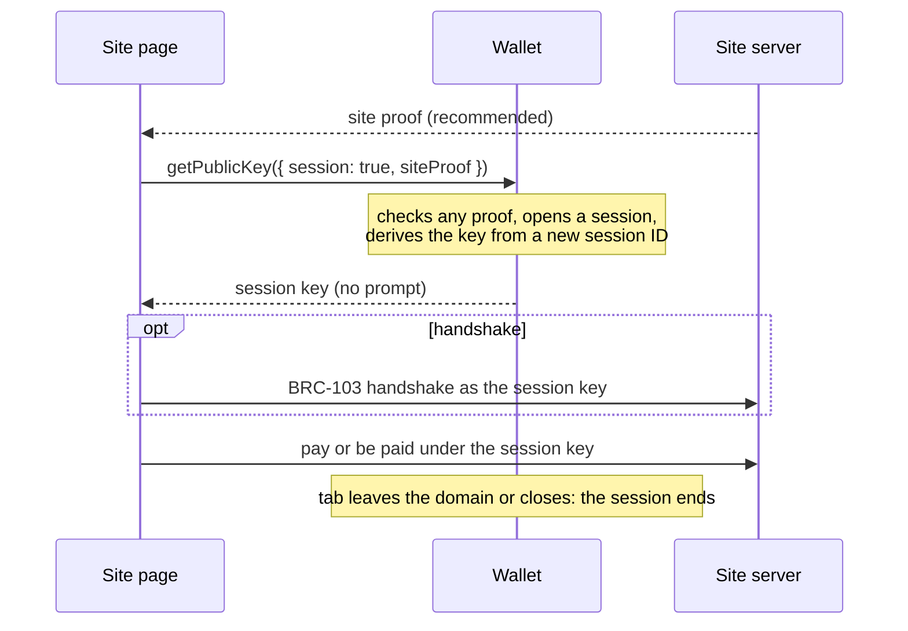

# BRC-XXX: Ephemeral Session Keys

*One key per visit, so that no one can link a user's visits by key. A companion to BRC-182 (Pairwise
Authentication) and BRC-103 (Peer-to-Peer Mutual Authentication and Certificate Exchange Protocol).*

Matthew Archbold (matthew.archbold@marstonenterprises.com), Marston Enterprises

## Abstract

A [BRC-100](../wallet/0100.md) (Unified, Vendor-Neutral, Unchanging, and Open BSV Blockchain Standard
Wallet-to-Application Interface) wallet can present a user to a site with its identity key, the same at
every site, or with a [BRC-182](./0182.md) (Pairwise Authentication) key, the same at one
site on every visit. This document specifies a third option for a user who has no account at a site:
an **ephemeral session key**, derived for one visit and never used again. No site, including the one
visited, can use it to link the user's visits, and the user can still pay and be paid during the
visit. It adds one wallet-interface flag and a reserved derivation, uses
[BRC-228](../payments/0228.md) (Unlinkable Payments under the Identity Paradigm) for payments sent
outside a session, and specifies what a wallet stores to spend what it receives.

## Where this fits: three ways a wallet presents a user

They escalate from most private to least:

| | Session key | Pairwise key | Identity key |
|---|---|---|---|
| Wallet call | `getPublicKey({ session: true })` | `getPublicKey({ pairwise: true, counterparty: <site key>, siteProof })` | `getPublicKey({ identityKey: true })` |
| Same key on | One visit to one site | Every visit to one site | Every site |
| Who can link the user by this key | No one | That site, across visits | Anyone who sees it |
| Site signs for its domain first | SHOULD | MUST | SHOULD |
| Wallet prompt | None needed | SHOULD, at least the first time at each site | MUST |
| Specified in | This document | BRC-182 | BRC-100, BRC-103 |

The methods that carry the key are the same in every mode: the BRC-103 handshake, BRC-105 (HTTP Service
Monetization Framework) payments and other payment protocols take whichever key the wallet returns.
This document is the baseline: the user discloses nothing that lasts beyond the visit, and escalates to
a pairwise or identity key only by choice.

## Motivation

A user who reads an article, buys one item or tips a creator has no reason to be recognised next time.
Today a wallet asked for a key gives the identity key, which every site sees and any two sites can
match. BRC-182 gives each site its own key, but that key is meant to last: it is what lets the user log
back in to an account. For a visit with no account, a lasting key is more than the site needs.

BRC-228 already removes the identity key from payments a user sends, using a fresh key per payment. It
does not cover a key the user presents for a visit, a handshake run during the visit, or money the
user receives. This document covers those, using BRC-228 for payments sent outside a session.

## Terminology

The key words MUST, MUST NOT, SHOULD, SHOULD NOT and MAY are to be interpreted as described in
RFC 2119.

- **Calling domain** and **site proof**: as defined in BRC-182.
- **Session**: one visit by a user to one calling domain in one browsing context, such as a tab. § 3
  says when it ends.
- **Session ID**: at least 16 bytes from a cryptographically secure random number generator, written in
  lowercase hex. A new one for every session. 16 bytes is RECOMMENDED; § 1 says why that is enough and
  how wallets handle other lengths.
- **Session key**: the user's key for one session, derived as in § 1.

## Specification

### 1. Deriving the session key

The session key is the [BRC-42](../key-derivation/0042.md) (BSV Key Derivation Scheme (BKDS)) child
of the user's master key with:

| Input | Value |
|---|---|
| Counterparty | `self` |
| Invoice number | `2-admin session-<session ID>` |

- The invoice follows [BRC-43](../key-derivation/0043.md) (Security Levels, Protocol IDs, Key IDs and
  Counterparties): security level `2`, protocol ID `admin session`, key ID the session ID.
- The counterparty is `self`, so only the user's wallet can compute the key, and only with the session
  ID. A party that learns the session ID without the master private key can't compute it; a party that
  obtains the master key without the wallet's records can't find the session IDs.
- The protocol ID starts with `admin`, which [BRC-44](../key-derivation/0044.md) (Admin-reserved and
  Prohibited Key Derivation Protocols) reserves for the wallet. As in BRC-182 § 1, a wallet MUST refuse
  any application request that names a protocol ID beginning with `admin`.
- A wallet MUST NOT reuse a session ID, and MUST NOT use a session key in more than one session.
- **Length.** The session key's secrecy rests on the master key; the session ID only has to be
  unguessable and unrepeated. 16 bytes meets both: a party holding a leaked master key would need
  about 2^128 derivations to find a session ID by guessing, and so to link a past session key to the
  user. A wallet MUST NOT generate a session ID shorter than 16 bytes, and MAY generate a longer one.
- **Interoperability.** The session ID enters the derivation as text, so a wallet re-derives a session
  key by placing the stored session ID in the invoice exactly as stored. A wallet MUST accept a stored
  or imported session ID of any length of 16 bytes or more, and MUST NOT change its case, length or
  encoding. A wallet that imports another wallet's records can then spend what was received under its
  session keys, whatever length that wallet chose.

### 2. The `session` flag

This document adds one optional boolean argument, `session`, to the same BRC-100 methods that BRC-182
§ 2 extends with `pairwise`, and to each payment output of `internalizeAction`.

`session: true` means: **perform this operation starting from the session key of the current session
for the calling domain, instead of from the master key.** Every other argument keeps its BRC-100
meaning.

#### 2.1 Rules

- `getPublicKey({ session: true })`, with no `protocolID`, returns the session key itself. If no
  session is open for the calling domain in this browsing context, the wallet opens one.
- `session: true` together with `identityKey: true`, `pairwise: true` or `privileged: true` MUST be
  rejected.
- A wallet MUST NOT answer a `session` call with the identity key or a pairwise key.
- A session key discloses nothing that lasts beyond the visit, so wallets SHOULD NOT prompt for it.
  Wallets MAY apply their usual protocol permissions.
- A wallet without this extension rejects `getPublicKey({ session: true })`, because BRC-100 requires
  `protocolID` and `keyID` for a derived key. An application SHOULD then ask for a pairwise or identity
  key, which the user is prompted for, or go without.

#### 2.2 A visit, start to finish

**Getting the key.** When the page first needs a key for the user, it calls:

```json
getPublicKey({ "session": true, "siteProof": { ... } })
```

The `siteProof` is the BRC-182 site proof and is recommended (§ 4). The wallet checks any proof that is
present, opens a session for the calling domain if none is open, and returns the session key with no
prompt:

```json
{ "publicKey": "<session key>" }
```

Every later call in the visit that passes `session: true` returns or uses the same key.

**Using it with no handshake.** The page gives the session key to its site wherever the site needs a
key for the user, for example as the receiver's key for a payment to the user (§ 6.2).

**Using it with a handshake.** A site that wants an authenticated channel runs BRC-103 (§ 5). The
user's `initialRequest` carries the session key:

```json
{
  "version": "0.1",
  "messageType": "initialRequest",
  "identityKey": "<session key>",
  "initialNonce": "<user nonce>"
}
```

The user's side verifies the site's response with
`verifySignature({ ..., "counterparty": "<site key>", "session": true })` and signs each request with
`createSignature({ "protocolID": [2, "auth message signature"], ..., "counterparty": "<site key>", "session": true })`.
The site verifies these against the session key exactly as it would against an identity key. BRC-105
payments then run inside the handshake, with the payment derived from the session key (§ 6.1).

**Ending.** When the tab leaves the domain or closes, the session ends (§ 3). The next visit gets a new
session ID and a new key, which the site can't link to this one.



### 3. When a session ends

- A session ends when its browsing context leaves the calling domain (a top-level navigation to another
  domain) or closes. In a private window, every session in it ends no later than when the window closes.
- A wallet MAY end a session sooner, for example after a period of inactivity, and MUST NOT continue
  one later.
- A wallet not reached through a browser MUST define its sessions so that each ends no later than the
  calling application closes.
- After a session ends, the wallet MUST NOT perform new operations with its key, except spending
  outputs already received under it (§ 6.3).

### 4. Site proof

- Sites SHOULD present a BRC-182 site proof in the first `getPublicKey({ session: true, siteProof })`
  of a session. A wallet MUST check a proof that is present, as in BRC-182 § 2.3, taking the proof's
  signer as the site key, and MUST refuse the call if the check fails. If the session then runs a
  BRC-103 handshake (§ 5), the wallet MUST require the site key in it to equal that signer.
- Without a valid proof, the wallet MUST NOT show the user any identity attached to the site key.
- Nothing about the user is at stake in a session key, so a missing proof does not stop the session. A
  wallet MAY let its user require a site proof before any key is disclosed.

### 5. Handshakes

A session needs no handshake. A site that wants an authenticated, encrypted channel for the visit MAY
run BRC-103, carried as in [BRC-104](./0104.md) (HTTP Transport for BRC-103 Mutual
Authentication), with the session key in the user's `identityKey` field. The messages are unchanged,
and the wallet operations BRC-103 performs on the user's side carry `session: true`. BRC-105 payments
then run inside that session.

### 6. Payments

#### 6.1 Sending

- **Inside a BRC-103 session,** a sender MUST derive the payment from its session key, calling
  `getPublicKey` with `session: true` for the payment output, and MUST report the session key as the
  sender's key. The receiver looks for the payment as coming from the session key, as BRC-182 § 5.1
  describes for pairwise keys.
- **Outside a session** (for example a payment protocol with no handshake), the sender SHOULD follow
  BRC-228: a fresh random key for each payment, in place of the identity key in `senderIdentityKey`.

#### 6.2 Receiving

The application gives the payer the session key as the receiver's key. The payer derives the output
as [BRC-29](../payments/0029.md) (Simple Authenticated BSV P2PKH Payment Protocol) specifies, with the
session key as the receiver's key. The receiver marks the output when it internalizes the payment:

```json
internalizeAction({
  "tx": "<Atomic BEEF>",
  "outputs": [{
    "outputIndex": 0,
    "protocol": "wallet payment",
    "paymentRemittance": {
      "derivationPrefix": "<prefix>",
      "derivationSuffix": "<suffix>",
      "senderIdentityKey": "<sender's key>"
    },
    "session": true
  }],
  "description": "<description>"
})
```

- The wallet MUST check that the output pays the key derived from its session key, and MUST store the
  session ID with the output.
- The wallet MUST NOT store an output whose key it cannot re-derive from what it stores. A wallet that
  cannot store the session ID MUST reject the output.

#### 6.3 Spending

When a wallet signs an input that spends an output received under a session key, it derives the
signing key in two steps:

```
session key   = BRC-42 child of the master key,  counterparty = self,    invoice 2-admin session-<session ID>
signing key   = BRC-42 child of the session key, counterparty = sender,  invoice from the remittance
```

Spending is not tied to the session: the output can be spent at any time after the session ends.

#### 6.4 Payments between two users of one site

Two users of a site can pay each other with session keys exactly as BRC-182 § 5.4 describes for
pairwise keys, with `session` in place of `pairwise`.

### 7. Storage and backup

- The session ID is not secret: computing the key from it also needs the master private key. Wallets
  MUST include it, with each output received under it, in their backups and exports, exactly as stored
  (§ 1).
- To keep backups small, a wallet SHOULD store each session ID once and refer to it from the outputs
  received under it, rather than repeat it on every output.
- A seed alone does not restore an output received under a session key, just as it does not restore
  any BRC-29 payment, whose prefix and suffix also exist only in the wallet's records. Users who back
  up their wallet's records lose nothing extra.
- A wallet MAY discard the session ID of a session in which nothing was received.

## 8. Relationship to other BRCs and prior art

- **BRC-182** is the next mode up: a key that lasts across visits to one site. This document reuses its
  calling domain, site proof and two-step spending.
- **BRC-228** covers the sender side for payments outside a session. This document adds the receiving
  side and the key presented during a visit. BRC-228 forbids deriving its key from a reusable wallet
  secret, because that key is never spent by its holder. A session key must be spendable when money is
  received under it, so it is derived from the master key with a random session ID that only the
  wallet stores (§ 1).
- **BRC-103 and BRC-105** carry a session key unchanged (§ 5).
- **Prior art.** Tor Browser's "New Identity" starts the user afresh; its design requires that "all
  linkable identifiers and browser state MUST be cleared" (§ 4.7). This document applies that
  requirement to wallet keys. IETF Privacy Pass (RFC 9576) makes each redemption unlinkable to the client's others.
  Receiver-side one-time keys appear in BIP-352 (Silent Payments) and ERC-5564 (Stealth Addresses),
  which recover them by scanning the chain. This document recovers them from the wallet's records, as
  BRC-29 already does.

## 9. Security considerations

- **A lost session ID loses what was received under it.** § 6.2 forbids storing an output whose key
  can't be re-derived, and § 7 requires backups to include the session ID.
- **The calling domain must come from the browser, not the page,** as in BRC-182 § 8.
- **The admin reservation is load-bearing,** as in BRC-182 § 8. A wallet that lets applications derive
  `admin` protocols lets a page ask for another session's key.

## 10. Privacy considerations

**What the session key prevents.** No site, including the one visited, can use the key to link one
visit to another, to the user's pairwise account at that site, or to the user's identity key.

**What it does not prevent.**
- **The transaction graph.** A payment's inputs come from the user's wallet, and BEEF carries the
  transactions they came from. Change returns to the same wallet, and the user's later payments spend
  from it. A party holding a payment can follow those links a few steps in each direction. The session
  key removes the one identifier that was the same in every payment and every login, at every site.
  Separating coins between sessions is a wallet matter outside this document.
- **The browser.** Cookies, storage, IP addresses and device fingerprints can let a site recognise a
  returning user whatever key the wallet presents. Protecting against them is the browser's work, and a
  private window is where a session key and a browser that forgets the visit work together. This
  document makes sure the wallet's keys don't add another way.
- **What the user discloses.** A user who logs in, or gives a name or an address, during a session is
  recognisable by that.

## 11. Test vectors

Generated with `@bsv/sdk` 2.8.11 using fixed test keys, the same test user and site as BRC-182. These
private keys are public: never use them for funds. All hex is lowercase; public keys are compressed.

**Session key (§ 1)**

| | Value |
|---|---|
| User master private key | `0000000000000000000000000000000000000000000000000000000000000011` |
| User identity key | `03defdea4cdb677750a420fee807eacf21eb9898ae79b9768766e4faa04a2d4a34` |
| Session ID (16 bytes) | `0102030405060708090a0b0c0d0e0f10` |
| Counterparty | `self` |
| Invoice | `2-admin session-0102030405060708090a0b0c0d0e0f10` |
| Session private key | `d14e90cceda24b569ae3e8a7e228e5a48302528ae31581cb29aea277ef7df8be` |
| Session key | `034e1d9c5069ea7bddb44d7c11edadbdeab9ef3ec91e5be0238d8a4619aafa9706` |
| Session key for session ID `1112131415161718191a1b1c1d1e1f20` | `02c2f3ba83d6978cbb41763701f0c97b36a6070aef87e19cde5b184c1fa062647c` |
| Session key for a 32-byte session ID `0102030405060708090a0b0c0d0e0f101112131415161718191a1b1c1d1e1f20` | `025556c0be6cfc5e2ea08167a9d736b157ae2875fc416a8165237b8b8271d9f240` |

**Payments (§ 6)**, site key `031be68a5a028f2601d0e80d468c344ba331d611b96c358b6032e8b4da0547fc11`,
protocol `[2, "3241645161d8"]`, prefix `cHJlZml4`, suffix `c3VmZml4`

| | Value |
|---|---|
| Site pays user: output key | `027c808744af7c89ac1c26c85033da61802aa1a4ff4bd3b71b0b36c825ddb5a06d` |
| Site pays user: user's two-step spending private key | `c38778cc8c593a66289033d58ec4a5135ad97e32327bea14a47a0ff8bc4e36be` |
| User pays site in a session: output key | `0358d0ec0a0bc7e81f3f88bb669d70e83f7253af6c49248997ca3092386387f827` |
| User pays site outside a session (BRC-228), ephemeral private key fixed for the vector only | `0000000000000000000000000000000000000000000000000000000000000055` |
| Its ephemeral key | `037962414450c76c1689c7b48f8202ec37fb224cf5ac0bfa1570328a8a3d7c77ab` |
| Its output key | `0280ed08628427d08d3cff2b9e5997a713d7fd63af95ec2a40d9c65cd5af3e27e2` |

**Checks an implementation should reproduce.**
- The session key differs from the identity key, from the BRC-182 pairwise key for the same site, and
  from the session key for any other session ID.
- A 32-byte session ID derives exactly as a 16-byte one: from its string, as stored. The same ID in
  uppercase gives a different key.
- A site that knows the identity key and the session ID cannot compute the session key.
- The two-step spending key matches the output the site paid; a one-step derivation from the master
  key does not.

## 12. Open questions

1. **Field names.** BRC-103's `identityKey` and BRC-29's `senderIdentityKey` carry a session or pairwise
   key under this document and BRC-182. The names describe the identity key only.
2. **Separating coins.** Whether wallets should fund each session from coins with no history shared with
   the user's other sessions, and how, so that the transaction graph links less.
3. **Sessions outside a browser.** § 3 lets such wallets define their own sessions. A common rule would
   help applications behave the same everywhere.

## 13. Implementations

None yet.

## References

- [BRC-29](../payments/0029.md): Simple Authenticated BSV P2PKH Payment Protocol
- [BRC-42](../key-derivation/0042.md): BSV Key Derivation Scheme (BKDS)
- [BRC-43](../key-derivation/0043.md): Security Levels, Protocol IDs, Key IDs and Counterparties
- [BRC-44](../key-derivation/0044.md): Admin-reserved and Prohibited Key Derivation Protocols
- [BRC-100](../wallet/0100.md): Unified, Vendor-Neutral, Unchanging, and Open BSV Blockchain Standard Wallet-to-Application Interface
- [BRC-103](./0103.md): Peer-to-Peer Mutual Authentication and Certificate Exchange Protocol
- [BRC-104](./0104.md): HTTP Transport for BRC-103 Mutual Authentication
- [BRC-105](../payments/0105.md): HTTP Service Monetization Framework
- [BRC-182](./0182.md): Pairwise Authentication
- [BRC-228](../payments/0228.md): Unlinkable Payments under the Identity Paradigm
- RFC 2119, Key words for use in RFCs to Indicate Requirement Levels
- RFC 9576, The Privacy Pass Architecture
- Tor Browser design document, § 4.7 New Identity, https://2019.www.torproject.org/projects/torbrowser/design/
- BIP-352, Silent Payments, https://github.com/bitcoin/bips/blob/master/bip-0352.mediawiki
- ERC-5564, Stealth Addresses, https://eips.ethereum.org/EIPS/eip-5564
