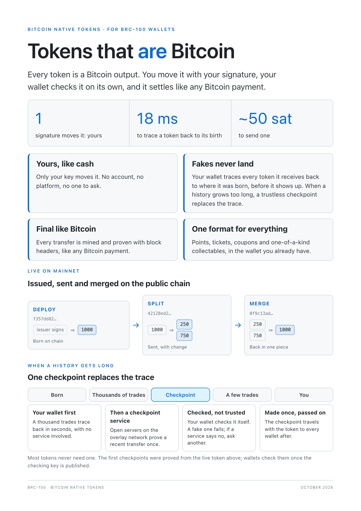

# BRC-251: Bitcoin Native Tokens (BNT): Definition and Wallet Duties

Brandon Cryderman / HandCash (brandongcryderman@gmail.com)

**Status:** Open

## Abstract

A wallet balance does not show whether a token depends on anyone besides its holder. This document makes that dependency visible in the script.

A **Bitcoin Native Token (BNT)** exists only as Bitcoin. Its amount is in the locking script, its validity follows from transaction bodies alone, only its holder moves it, and only Bitcoin settles it. Six objective tests define the class, so anyone can decide from a token's rules whether it is native.

The family's other class is the **Issuer-Permissioned Token (IPT)**: a Bitcoin token whose issuer co-signs every transfer until it releases the asset. A BNT needs only Bitcoin. An IPT also needs its issuer, and a wallet labels it separately.

The two classes share one output layout, one asset id, one deploy payload, one proof package and one delivery format. They differ only in their marker and their spending clause, so a reader decides the class from the first three bytes of the script before reading anything else. Draft BRC-255 ([#335](https://github.com/bsv-blockchain/BRCs/pull/335)) specifies the BNT format and draft BRC-253 ([#333](https://github.com/bsv-blockchain/BRCs/pull/333)) the IPT format. This document defines the shared terms and the duties of every wallet that holds either.

[](media/0251/bnt-brochure.pdf)

## Motivation

Many token designs rely on a party besides the holder: an overlay that admits transfers, an indexer whose answer is the balance, or an issuer that signs each move or can freeze a holder. Those designs serve real needs. But their validity depends on that party's answer, and a user cannot tell from a balance which kind of asset they hold.

This family puts the difference in the script. A native asset depends on no one's answer, and the tests below let anyone check that. An asset that needs its issuer says so in its marker, sits in its own filing and is labeled separately. There is nothing in between, so a wallet never has to judge how native a token is.

One layout for both classes keeps this cheap. A wallet parses one prefix, stores one kind of proof and delivers one kind of message. The clause alone decides who must sign.

## The family

| Concern | Document |
|---|---|
| Definition, shared terms, wallet duties | This document |
| BNT format: outputs, deploy, supply, proofs, delivery, filing, access | Draft BRC-255 ([#335](https://github.com/bsv-blockchain/BRCs/pull/335)) |
| IPT format: the same outputs under `ipt`, acceptance, beacon, release | Draft BRC-253 ([#333](https://github.com/bsv-blockchain/BRCs/pull/333)) |
| Shorter proofs without trust | Draft BRC-252 ([#321](https://github.com/bsv-blockchain/BRCs/pull/321)) |
| Market listings and settlement | Draft BRC-254 ([#334](https://github.com/bsv-blockchain/BRCs/pull/334)) |
| Wallet asset profiles and `listAssetProfiles` | Draft BRC-214 |
| Wallet interface | [BRC-100](../wallet/0100.md) |
| Permission schemes | [BRC-99](../wallet/0099.md), [BRC-123](../wallet/0123.md) |
| Finality | [BRC-67](../transactions/0067.md) SPV |

MUST, MUST NOT, SHOULD and MAY express requirements for conforming implementations.

## Terms

Every document of the family uses these words with these meanings.

- **Asset.** A fungible **token**, or an **item**: a deploy with a supply of exactly one.
- **Deploy.** The output that creates an asset and fixes its rules.
- **Asset id.** `HASH160(deploy txid ‖ index)`, 20 bytes, written as 40 lowercase hex characters.
- **Marker.** The first three bytes of every asset output: `bnt` for a BNT, `ipt` for an IPT.
- **Clause.** The spending condition after an output's prefix. It alone differs between the classes.
- **Issuer key.** A BRC-42 child of the issuer's identity key that signs the deploy and any spend of a mint authority.
- **Holder key.** A fresh BRC-42 child public key per output. No asset output is locked to an identity key.
- **Authority.** An output whose spender may mint, within the deploy's supply policy.
- **Filing.** The wallet basket an asset's outputs are recorded in. Each class and kind has its own.
- **Remittance.** The derivation prefix, suffix and sender identity key that lead back to a holder key.
- **Proof package.** The transactions a recipient needs to check a transfer, in Extended Format.

## Specification

### 1. Bitcoin Native Tokens

A token is a **Bitcoin Native Token (BNT)** when every one of these holds, decided from the token's rules alone:

1. **In the script.** Each output's asset id and amount are in its locking script. Nothing outside the transaction (tags, `customInstructions`, messages, indexes) adds to, removes or changes them.
2. **Valid from transactions alone.** Whether an output is valid is a function of transaction bodies back to the deploy, which anyone holding them can compute. No issuer, signer, overlay, indexer, oracle or attester takes part, and no party's answer can make an output valid or invalid.
3. **Moved by its holder alone.** The holder's signature alone transfers an output. No script branch lets anyone else move, freeze, reclaim or release it, and no transfer needs another party's signature or approval.
4. **Rules fixed at deploy.** Supply, minting authority and every validity rule are fixed by the deploy and checked on each transaction. Nobody can change them later.
5. **Settled by Bitcoin.** An output is final when its transaction is mined, proven by SPV ([BRC-67](../transactions/0067.md)) against block headers. No other settlement, reversal or clawback exists.
6. **Peer to peer.** The evidence of validity travels with the payment and is named by txid, so any source can carry it and none can forge it. The transport never affects validity.

**A UTXO state machine.** Together the tests make a BNT a state machine on Bitcoin's unspent outputs. Each unspent asset output is part of the asset's state, each transaction is a transition, and the deploy fixes the transition rules. Script decides who may make a transition, the deploy's rules decide whether it is valid, and mining orders it. Anyone holding the same transactions computes the same state, so two peers agree without asking a third. A BRC-100 wallet holds that state as outputs in a basket, makes transitions with `createAction` and `signAction`, and records the ones it receives with `internalizeAction`.

A shortcut that lets a recipient skip part of the evidence keeps an asset native only when the recipient can check it with no trusted signer, as draft BRC-252 requires.

The tests are about rules, not encodings. Draft BRC-255 is this family's BNT format. This document profiles no other.

### 2. Issuer-Permissioned Tokens

An asset is an **Issuer-Permissioned Token (IPT)** when its clause requires an issuer's countersignature on every transfer until a published release removes that requirement. It fails tests 2, 3 and 5 by design. The issuer takes part in every transfer's validity and can refuse or freeze a holder, and a transfer is final against the sender once accepted, before Bitcoin settles it. After a release an IPT moves with its holder's signature alone. Its history was still accepted by an issuer, so it stays an IPT.

IPT exists for assets whose value comes from their issuer, such as stablecoins, handles and tickets. Draft BRC-253 specifies it.

### 3. One layout, two markers

Every asset output of the family has the form

```
<marker ‖ asset id> <amount> OP_2DROP <clause>
```

with the deploy, authority and capped-authority forms of BRC-255 §1. The marker is `62 6e 74` (`"bnt"`) for a BNT and `69 70 74` (`"ipt"`) for an IPT.

- A marker never carries both classes. An output under `bnt` with a clause other than BRC-255's is no asset. An output under `ipt` with a clause other than BRC-253's is no asset.
- A reader decides the class from the marker before it reads the payload, the clause or any tag.
- The deploy payload, supply policy, collections, proof package, delivery envelope and remittance are BRC-255's in both classes. BRC-253 adds only what makes an asset countersigned.

### 4. Wallet duties

A wallet that holds assets of either class MUST meet all of these.

1. **Never conflate.** BNT and IPT have separate balances, labels and filings: `bntft` and `bntnft` for BNT tokens and items, `iptft` and `iptnft` for IPT. A wallet MUST NOT show an IPT in a BNT balance or call it native, and SHOULD label IPT wherever it labels BNT.
2. **Credit only what checks out.** An output counts only once the format's validity rule has passed for it and its remittance derives the key in its lock. Display fields, tags, `customInstructions` and message claims never add to a balance.
3. **Show finality honestly.** A BNT transfer is unconfirmed until mined. An IPT transfer is final as BRC-253 says, and no sooner.
4. **Moves belong to the wallet.** Applications view assets through the BRC-99 schemes of each format and never write, spend or relinquish an asset output. The wallet builds every spend, the proof package and the remittance itself, checks the format's rules before and after `signAction`, and aborts on any mismatch.
5. **Grants never cross.** A grant for one filing gives nothing in another, and payment, auto-pay and coin grants never cover an asset.
6. **Keep remittance.** A holder key is found again only from its remittance. A wallet MUST keep it with the output and in any history backup. A sender MUST keep the remittance of every undelivered transfer until the recipient's box accepts it.
7. **Keep other code away.** Change, consolidation, healing and coin-selection code MUST NOT spend, move or count an asset output.
8. **No silent formats.** A token that is neither a BNT nor an IPT of this family is not shown under either name. A wallet that recognises one only to keep it out of its coin paths does not hold it as an asset.

## Security considerations

- **Class by marker.** The class is in the first three script bytes and each marker admits one clause, so a forger cannot make an IPT read as native, or a native asset read as countersigned, without failing the parse.
- **Mined is not valid.** Miners do not check amounts, so an invalid transfer can be mined. A wallet credits only what its walk validated, back to the deploy or to a step proof it checked (Rationale, Why native).
- **Claims.** Tags, `customInstructions` and message members are forgeable. Amounts come from scripts and validity from the format's rule.
- **Remittance is custody.** A derived output cannot be found by scanning an address. Losing its remittance loses the output until a backup or the sender's copy restores it.
- **Privacy.** Every output has its own holder key, so the chain does not link a holder's outputs to each other or to its identity. An IPT issuer sees every transfer of its asset by design.

## Rationale

**Why native.** A Bitcoin payment rests on four things: a script that says who may spend, rules that say what a transaction may do, an order that settles which spend came first, and evidence the payee can check. A BNT gets each of them from Bitcoin and adds no party:

| | Satoshis | BNT |
|---|---|---|
| Who may spend | Script, run by miners | Script, run by miners |
| What a transaction may do | Miners check that no satoshis are created | The recipient checks conservation and supply from transaction bodies (BRC-255 §7) |
| Which spend came first | Mining, proven by SPV | Mining, proven by SPV |
| Evidence | Travels with the payment (BRC-95) | Travels with the payment (BRC-255 §6) |

Miners do not check token amounts: `OP_2DROP` removes them before the clause runs, so a mined transaction may break an asset's rules. A recipient never treats mined as valid. It walks back to the deploy itself, as a full node checks the chain, but only over the asset's own transactions and only once per hop. SPV settles a transfer, and the walk decides its validity. A BNT trusts miners for ordering only, as every SPV payment does, and trusts no one for supply: not miners, not an indexer, not its issuer.

Native therefore means needing nothing but Bitcoin: transactions, block headers and the holder's key. It does not mean that consensus enforces the amount. A token whose amounts miners enforce by covenant script also passes §1, at the cost of far larger scripts. This family chooses small outputs and the recipient's walk. The walk grows with an asset's history. Draft BRC-252 bounds it with step proofs, trustless checkpoints that wallets pass on with the token. A proof that the recipient checks against a published verifying key stands in for the history behind a mined transaction, and whoever made the proof decides nothing.

**Two classes, not a scale.** A token either depends on someone's answer or it does not. A scale of "mostly native" would hide that dependency behind a score. Two classes, each with its own marker, keep it visible in every output.

**One layout.** The classes differ in who must sign, so that is the only thing that differs on chain. Sharing everything else gives one parser, one proof store and one delivery path. Because the marker comes first, a wallet cannot treat the two classes alike by accident.

**Wallet-only moves.** Every rule above is checked when the wallet builds a spend. An application that could write asset outputs or receive holder signatures could break conservation or the class boundary. Applications therefore only view assets, and the wallet moves them.

## Implementations

HandCash Desktop and Mobile: BNT under BRC-255 with the filings, access and duties above. IPT filings and the `ipt` marker are reserved for BRC-253.

## References

1. Draft BRC-255 ([#335](https://github.com/bsv-blockchain/BRCs/pull/335)) — Bitcoin Native Tokens (BNT): Compact Format
2. Draft BRC-253 ([#333](https://github.com/bsv-blockchain/BRCs/pull/333)) — Issuer-Permissioned Tokens (IPT)
3. Draft BRC-252 ([#321](https://github.com/bsv-blockchain/BRCs/pull/321)) — Short Proofs for Bitcoin Native Tokens
4. Draft BRC-254 ([#334](https://github.com/bsv-blockchain/BRCs/pull/334)) — Market Listings for Bitcoin Native and Issuer-Permissioned Tokens
5. [BRC-100](../wallet/0100.md) — Wallet-to-Application Interface
6. [BRC-99](../wallet/0099.md) — P Baskets: Allowing Future Wallet Basket and Digital Asset Permission Schemes
7. [BRC-123](../wallet/0123.md) — Basket Permission Scheme Registry and Governance
8. [BRC-42](../key-derivation/0042.md) — BSV Key Derivation Scheme
9. [BRC-67](../transactions/0067.md) — Simplified Payment Verification
