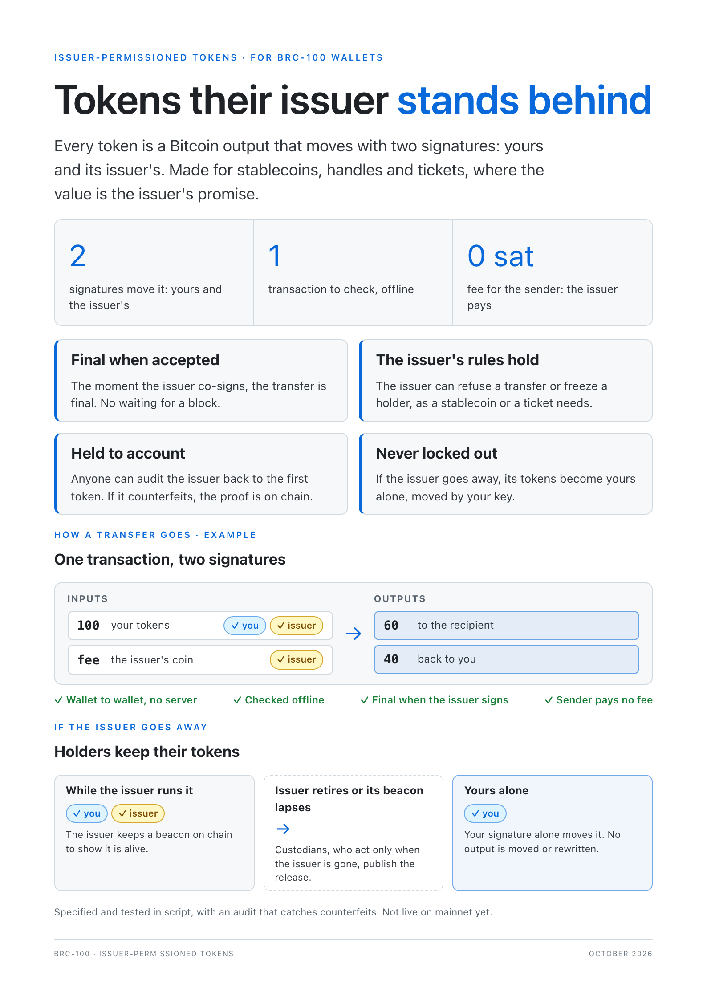

# BRC-253: Issuer-Permissioned Tokens (IPT): Countersigned Tokens and Items

Brandon Cryderman / HandCash (brandongcryderman@gmail.com)

**Status:** Open

## Abstract

Some assets get their value from their issuer: handles, stablecoins, tickets. The issuer needs to refuse a transfer or freeze a holder, and holders need to keep the asset when the issuer is gone. Art, collectables and open tokens need no third party. They are Bitcoin Native Tokens.

An Issuer-Permissioned Token (IPT) is a Bitcoin token whose issuer co-signs every transfer. It is the second class of draft BRC-251 ([#320](https://github.com/bsv-blockchain/BRCs/pull/320)), beside Bitcoin Native Tokens (BNT). Every IPT output has a locking script that needs two signatures, the holder's and the issuer's. The issuer's signature is the acceptance. A transfer the issuer refused is not valid Bitcoin, so it can never be broadcast, mined or credited.

In everything else an IPT matches a BNT. It uses the output layout, asset id, payload, supply policy, items, collections, proof package and delivery of draft BRC-255 ([#335](https://github.com/bsv-blockchain/BRCs/pull/335)), and differs only in its marker, `ipt`, and its clause. An asset is either a fungible **token** or a non-fungible **item**. An item is a deploy with a supply of exactly one. Tokens file under `iptft` and items under `iptnft`.

The sender asks the issuer for acceptance peer to peer, over a draft BRC-246 ([#248](https://github.com/bsv-blockchain/BRCs/pull/248)) data channel or through a [BRC-33](../peer-to-peer/0033.md) message box. The issuer publishes no endpoint. The recipient checks a transfer offline from one [BRC-30](../transactions/0030.md) Extended Format transaction, about 0.8 KB, and walks no lineage. Once those checks pass, the transfer is final against the sender. Anyone can audit the issuer by walking the asset back to its deploy, and an issuer that counterfeits leaves evidence.

Every output also names a **release**: the hash of a secret, or a key set, held by custodians who act only when the issuer is gone. When the issuer retires, or its on-chain beacon lapses, the custodians spend the beacon on its release branch and publish what opens it. From then on every holder spends with its own signature alone, and the asset is owner-only. A freeze holds while the issuer is alive. Holders are never locked out after it is gone.

A BNT needs only Bitcoin. An IPT also needs its issuer, which takes part in every transfer's validity, can refuse or freeze a holder, and makes a transfer final once accepted, before Bitcoin settles it. An IPT is therefore its own class. A wallet MUST NOT present an IPT as a BNT or show it in a BNT balance, and SHOULD label it IPT wherever it labels BNT.

[](media/0253/ipt-brochure.pdf)

## Motivation

An issuer of a regulated asset, such as a stablecoin, must be able to refuse a transfer: from a frozen holder, to an unregistered recipient, or over a limit. Today an overlay does this that admits each transfer ([BRC-207](../wallet/0207.md)), with attestations so that a payee can accept offline ([BRC-175](../payments/0175.md)). That design has two costs:

- **Latency.** A wallet needs a current overlay answer before it spends or accepts. Accepting before that answer needs attestations, a walk to attested outputs, and settlement later.
- **Unclear outcomes.** A payment can be credited and later reversed when settlement fails, or held without being credited. An attestation shows the output was admitted, not that it is still unspent. A payer's inputs stay reserved after a decline. Trust modes, complete-set rules and eviction all decide what a balance means.

Both costs have one cause. Acceptance is a statement about a transaction, made outside it. A transaction can exist without the statement, and every party has to reason about the gap.

This document closes the gap. The issuer's acceptance is a signature inside the transaction, and the locking script requires it. There are three outcomes, each final: the issuer signed, the issuer refused, or the request was cancelled.

**Scope.** An asset that needs a third party to agree to every transfer cannot be paid with the sender offline, and has no value that outlives that party. One party may still be offline: the recipient. The sender and the issuer must be online for the transfer. The delivery waits in the recipient's message box, and the recipient resolves it when it next connects, with no network needed for the check itself. After a release (§9) the issuer is no longer needed. The recipient may still be offline, but credits the transfer only once it is mined. This document is meant only for assets whose value comes from their issuer: a handle registry, a stablecoin, a ticket. It does not try to keep issuer control after the issuer is gone. It only guarantees that holders can move what they hold.

## Relationship to other documents

| Concern | Document |
|---|---|
| The IPT class and wallet duties | Draft BRC-251 ([#320](https://github.com/bsv-blockchain/BRCs/pull/320)) |
| Output layout, asset id, payload, supply, items, collections, proof package, filing tags | Draft BRC-255 ([#335](https://github.com/bsv-blockchain/BRCs/pull/335)) |
| Transfer encoding for the recipient | [BRC-30](../transactions/0030.md) Extended Format |
| Auditing issuers as an overlay service | Draft BRC-257 ([#343](https://github.com/bsv-blockchain/BRCs/pull/343)) §8 |
| Live channel to the issuer | Draft BRC-246 ([#248](https://github.com/bsv-blockchain/BRCs/pull/248)) |
| Store-and-forward box | [BRC-33](../peer-to-peer/0033.md) |
| Encrypted content | [BRC-78](../peer-to-peer/0078.md) |
| Issuer handle resolution (optional) | [BRC-169](../peer-to-peer/0169.md) §5 |
| Issuer, holder and decision keys | [BRC-42](../key-derivation/0042.md), [BRC-43](../key-derivation/0043.md) |
| Proving a holder key belongs to an identity | [BRC-69](../key-derivation/0069.md) specific linkage, in transit per [BRC-72](../key-derivation/0072.md) |
| Remittance fields | [BRC-37](../outpoints/0037.md) `customInstructions` |
| Basket namespace, scoped access, row keys | [BRC-123](../wallet/0123.md), [BRC-99](../wallet/0099.md), [BRC-164](../wallet/0164.md) |

This document defines the IPT format of BRC-251 §2 and takes everything that is not about the issuer from BRC-255. Where it cites a BRC-255 section, that section applies with the marker `ipt` in place of `bnt`.

MUST, MUST NOT, SHOULD and MAY express requirements for conforming implementations.

## Terms

BRC-251's terms apply, with the marker `ipt`, and BRC-255's encodings of them. In addition:

- **Issuer keys.** `m` and `n` with `1 ≤ m ≤ n ≤ 5`, and `n` issuer keys (§2), fixed at deploy. Any `m` of them accept a transfer. These keys are online and sign automatically under the issuer's policy.
- **Release.** What lets holders spend once the issuer is gone, fixed at deploy: the `HASH160` of a release secret, or a key set of `k` of `j` keys with `1 ≤ k ≤ j ≤ 5`, none of them an issuer key. Its custodians act only once the asset has ended (§9). Custodians the issuer cannot outvote SHOULD be able to meet the release on their own, so that a release survives the issuer vanishing. A release only the issuer can meet freezes the asset for good if the issuer stops without releasing it. A wallet MUST NOT choose such a release by default, and MUST tell the issuer this consequence before deploying one.
- **Countersign clause.** The §2 locking script.
- **Countersigned output.** An output with the `ipt` marker and the asset id, and the countersign clause naming the deploy's issuer keys and release.
- **Acceptor.** The issuer keys, which accept transfers while the asset is live. A released asset has no acceptor.
- **Beacon.** A 1-satoshi output that the issuer re-spends to show on chain that it is alive (§9).
- **Live, ended, released.** The phases of an asset, read from its beacon chain (§9).
- **Accepted transaction.** A transaction whose every asset input is unlocked on the issuer branch (§11).

## Specification

### 1. Output forms

An asset uses the output forms of draft BRC-255 ([#335](https://github.com/bsv-blockchain/BRCs/pull/335)) §1 under its own marker, the three bytes `69 70 74` (`"ipt"`):

```
deploy:     <"ipt">             <supply> <payload> OP_2DROP OP_DROP <clause>
held:       <"ipt" ‖ asset id>  <amount> OP_2DROP <clause>
authority:  <"ipt" ‖ asset id>  OP_0     OP_2DROP <clause>
capped:     <"ipt" ‖ asset id>  OP_0 <units issued> <members issued> OP_2DROP OP_2DROP <clause>
```

The asset id is BRC-255's, `HASH160(deploy txid ‖ index)`. BRC-255's marker `bnt` never carries a countersigned output, so no marker spans both classes, and a BNT reader never admits an asset of this document.

### 2. Countersign clause

**One issuer key:**

```
<holder key> OP_CHECKSIGVERIFY
OP_IF
  <issuer key> OP_CHECKSIG
OP_ELSE
  OP_HASH160 <HASH160(release secret)> OP_EQUAL
OP_ENDIF
```

**A shared issuer set:** the same, with `OP_m <key 1> … <key n> OP_n OP_CHECKMULTISIG` in place of `<issuer key> OP_CHECKSIG`, where `1 ≤ m ≤ n ≤ 5`, `2m > n`, and keys are in the order the deploy lists them.

**Key-set release:** the same, with `OP_k <release key 1> … <release key j> OP_j OP_CHECKMULTISIG` in place of `OP_HASH160 <HASH160(release secret)> OP_EQUAL`, where `1 ≤ k ≤ j ≤ 5` and no release key is an issuer key. Each custodian generates its own key, so no one has to delete a secret. It costs 33 bytes per release key in every output.

**Unlocking scripts:**

```
issuer:            <issuer signature> OP_1 <holder signature>
shared set:        OP_0 <signature 1> … <signature m> OP_1 <holder signature>
released:          <release secret> OP_0 <holder signature>
key-set release:   OP_0 <release signature 1> … <release signature k> OP_0 <holder signature>
```

The holder signs with sighash `ALL | ANYONECANPAY | FORKID` (`0xC1`), or `SINGLE | ANYONECANPAY | FORKID` (`0xC3`) for a sale (§6). An issuer signs with `ALL | FORKID` (`0x41`). A BRC-100 wallet makes each signature with `createSignature`, `hashToDirectlySign` set to the double SHA-256 of the input's sighash preimage (BIP-143 with FORKID) under that sighash type, for the key's protocol, key ID and counterparty, and passes the unlocking script to `signAction`. No key leaves the wallet. A wallet MUST parse a clause exactly and re-encode it. Only the canonical encoding counts.

The holder signs only its own input and every output, so the acceptor can add its fee input without changing what the holder approved. The acceptor then signs everything, so no input or output can change after acceptance.

**Issuer keys.** An issuer key is the BRC-42 child of the identity key named in `iss`, derived as BRC-255 §3 does but for protocol `[2, "ipt issuer"]`, key ID `1` and counterparty `anyone`. The deploy MUST be signed by issuer keys as BRC-255 §3 requires.

**Holder keys.** A holder key is never an identity key. It is the BRC-42 child for protocol `[2, "ipt holder"]`, key ID `<derivationPrefix> <derivationSuffix>`, with the holder's identity key as counterparty, or the sender's own for an output it keeps, derived as BRC-255 §8 does. The sender draws a fresh prefix per transfer and a fresh suffix per output. A deploy output is derived the same way. The holder reaches the key through BRC-100 `getPublicKey` and `createSignature`. No two outputs share a holder key, so a chain observer cannot link one holder's outputs to each other or to its identity.

Script timelocks are not available for the release branch, because BSV restored `OP_CHECKLOCKTIMEVERIFY` and `OP_CHECKSEQUENCEVERIFY` to no-ops at Genesis. When the release may be used is read from the beacon chain (§9), not from a script condition.

### 3. Deploy

A deploy is a BRC-255 §2 deploy under the marker `ipt`. Its payload is BRC-255's, with `mode` `"countersign"` and these keys:

| Key | Type | Meaning |
|---|---|---|
| `bcn` | bytes | The beacon's first outpoint, 36 bytes (§9) |
| `sil` | uint | The silence period in seconds, at least 604800 (7 days); only in the deploy that first names the beacon |
| `rel` | bytes | `HASH160(release secret)`, 20 bytes; absent with a key-set release |
| `relk` | array of bytes | Key-set release: the release keys, 33 bytes each |
| `k` | uint | The key-set release threshold |

The deploy output's clause MUST be a §2 clause with the issuer keys of `iss` and `m` and, as the deploy names, `rel` or `relk`. The issuer is the first holder of every output the deploy writes, under its own holder key. Supply policy, items and collections are BRC-255 §4 and §5: an item is a supply-1 deploy, and a member deploy spends its collection's authority, which needs the issuer. One transaction MAY deploy up to 256 assets.

The payload MUST NOT contain a URL. Acceptors are reached by identity key, never by an address in the asset. A wallet obtains the deploy body once per asset from any source, and keeps it only when its txid and index hash to the asset id.

Copying an issuer's keys into a deploy gives a forger nothing to hand out. The deploy is no asset without the issuer's signature (BRC-255 §3), its outputs move only with an acceptor's countersignature, and a recipient never resolves a deploy (§11).

**Closure.** Every output carrying the asset id MUST use the deploy's clause, with the same issuer keys and release, and any holder key. An acceptor MUST NOT countersign a transaction that writes the asset id to any other script. A wallet MUST treat an output of the asset with another clause as not a holding of the asset. Every spend needs an acceptor, and acceptors countersign only transactions that keep the clause, so every holding traces through accepted transactions back to the deploy. Nobody has to walk that history.

### 4. Building a transfer

A sender builds one transaction:

1. Inputs are resolved countersigned outputs of one asset. It has no other inputs. The acceptor adds the only other one.
2. Outputs are countersigned outputs: one per recipient, locked to the recipient's holder key (§2) for fresh remittance strings, and change, when needed, locked to a holder key of the sender's own. If the acceptor's current terms (§8) ask for a fee in tokens, it adds that output too. Amounts sum exactly to the inputs.
3. Each output carries 1 satoshi. The sender does not fund the transaction.
4. The user approves the asset, the amount and each recipient. A satoshi payment grant, an auto-pay limit or a generic basket grant MUST NOT approve it.
5. The holder signs every input (sighash `0xC1`). Each unlocking script holds only `<holder signature>`. The acceptor completes it as `<issuer signature> OP_1 <holder signature>` (§2).

The sender serializes this transaction in Extended Format. Its **request id** is the lowercase hex SHA-256 of those bytes.

### 5. Requesting acceptance

The sender seals a request to the acceptor per BRC-78:

```json
{
  "v": 1,
  "t": "request",
  "asset": "<asset id, 40 hex>",
  "ef": "<Extended Format transaction, base64>",
  "recipients": [{
    "vout": 0,
    "identityKey": "<66 hex>",
    "derivationPrefix": "<remittance string>",
    "derivationSuffix": "<remittance string>",
    "encryptedLinkage": "<base64>",
    "encryptedLinkageProof": "<base64>"
  }]
}
```

`recipients` names the identity behind each output, so the acceptor can apply its rules about who may hold the asset, and proves it. `encryptedLinkage` and `encryptedLinkageProof` are what BRC-100 `revealSpecificKeyLinkage` returns for protocol `[2, "ipt holder"]` and that output's key ID, with the holder's identity key as counterparty and the acceptor key the request is sealed to as verifier: the BRC-69 specific linkage, encrypted to that acceptor per BRC-72. A request sent to several acceptor keys, or to the cosigners of a shared set, carries an entry encrypted to each one. The acceptor decrypts the linkage and checks that `identityKey + linkage·G` is the output's holder key. That equation is the proof. Whoever spends the output needs the named identity's private key, whatever linkage the sender chose. It reveals that one output's owner to the acceptor and nothing more.

A sender-funded trade (§6) adds `"funding": "sender"`. Its plain outputs need no entry.

The sender MUST list every output, its change included, with its own identity key for change.

The sender sends it on an open BRC-246 data channel to any device of an acceptor key. Otherwise it sends it through BRC-33 `sendMessage` to that key's message box, in box `ipt`. It finds that box by the issuer's handle (`hdl`) per BRC-169, or by a box it already knows for that key. A sender MAY send the same request to several acceptor keys, because a request is accepted at most once (§6).

Requests go to the issuer only while the asset is live. A released asset needs no request. The holder spends on the release branch itself (§9).

While a request is outstanding, the sender MUST NOT spend its inputs in a different transaction. It MAY send the same request again. Repeating a request is safe.

### 6. Acceptor processing

The acceptor keeps the set of countersigned outputs accepted and not yet seen spent. The outputs of its own deploys enter that set when the deploy is broadcast. For a request it:

1. checks that every input is in that set and is not reserved by another request;
2. checks every holder signature, the clause of every output, and that amounts sum exactly;
3. checks each entry's linkage (§5), refusing with `recipient` an output whose linkage does not open or does not give its holder key, and an output that is neither listed nor locked to an input's holder key. It applies its own policy to the identities behind the inputs and the listed outputs: frozen holders, registered recipients, sanctions, limits. It knows who holds each input because it recorded the identity behind every output it accepted;
4. checks its fee terms;
5. in one durable step: marks the inputs spent by this request, adds one input of its own whose value covers the network fee and any carrier-satoshi deficit, countersigns every asset input on the issuer branch, signs its own input, and records the signed transaction under the request id;
6. replies, delivers (§10) and broadcasts the transaction. Replying does not wait for broadcast.

**Accept once.** An acceptor MUST NOT countersign two transactions spending the same output, except as a sender-funded trade allows (below). A repeated request returns the transaction already recorded. The fee input adds no change output, because the holder already signed the outputs. The acceptor keeps inputs of a few fixed sizes for this.

The only non-asset input belongs to the acceptor, so the sender has nothing left to double spend once a transfer is accepted.

**Replacement.** An accepted transaction may never be mined. The network may refuse it, for example for too low a fee, or one of the acceptor's own inputs may be spent elsewhere. Its fee cannot be raised, because every sequence is final and the acceptor owns no output to spend in a child. The acceptor MAY then countersign a replacement, and only when all of these hold:

1. the network refused the original, or a transaction other than the original that spends one of the original's non-asset inputs is mined;
2. no output of the original is an input of another transaction the acceptor accepted;
3. the replacement spends the same asset inputs with the same holder signatures, writes byte-identical outputs in the same order, and differs only in the acceptor's own input.

The holder's `0xC1` signature covers only its own input and the outputs, so it stays valid and the holder is not asked again. The replacement and the original spend the same asset inputs, so at most one is mined, and both pay the same holders the same amounts. The acceptor records the replacement under the original request id, answers a repeated request with it, and delivers it (§10). It carries the same spend, so it is not a second acceptance.

When the acceptor accepts a spend of an output whose transaction is not yet mined, its input SHOULD pay the fee of both, so the new transaction carries its parent.

**Shared issuer sets.** An issuer set of `m` of `n` keys with `n ≥ 2` belongs to `n` **cosigners**, each holding one key and keeping its own accept-once record. `2m` MUST be greater than `n`, so any two quorums share a cosigner, and that cosigner refuses the second of two spends of one output. An issuing wallet refuses a set that breaks this. Such a transfer differs from §4 to §6 in five ways.

1. The sender funds the transaction. After the asset inputs it adds inputs of its own that are not countersigned outputs, covering the fee, and it signs them `SIGHASH_ALL|FORKID`. Every cosigner then signs the same bytes. All sequences are final, so `nLockTime` is free: the sender sets a fresh value so that each attempt has a new request id.
2. The sender sends the request to every cosigner. It MAY attach `beef`, the request's unproven ancestors as BRC-95 Atomic BEEF.
3. A cosigner accepts an input it did not record when the transaction that wrote it spent every countersigned input on the issuer branch with a valid unlocking script and resolves (§11). The deploy output is accepted by definition. In one durable step it reserves the asset inputs under the request id and countersigns each of them. It adds no input and replies `cosigned` (§7).
4. A cosigner's refusal of a request is final: it never signs that request id later.
5. The sender orders `m` countersignatures by the issuer set's key order, as `OP_CHECKMULTISIG` requires, checks each input, and broadcasts. If fewer than `m` cosigners can still sign, the request is refused. The sender then sends `cancel` with more than `n − m` signed refusals of that request to each cosigner that signed it. Such a cosigner frees its reservation on that proof, because without it its signature may already belong to a quorum.

A cosigner also frees its reservation once a transaction other than the request that spends one of the request's non-asset inputs is mined. The request can then never be mined, so the signature cannot complete a valid spend. This needs no other cosigner. A sender that can gather neither `m` countersignatures nor the refusals, because cosigners are offline, frees its asset inputs by spending one of its own fee inputs elsewhere and showing that transaction once it is mined.

A sender that funds its own transfer can void a countersigned transfer by double spending a fee input. It gets back only the asset inputs it already held, but a recipient that had credited the transfer would lose it. So a recipient credits a transfer of a shared-set asset only once it is mined, as after a release (§9).

The other cosigners join by consent. The issuing wallet sends each of them `{ "v": 1, "t": "join", "asset": "…", "deploy": "<deploy transaction, hex>" }`. A cosigner countersigns nothing for the asset until its user joins.

**Sender-funded trades.** A trade pays satoshis, or another asset, against countersigned inputs in one transaction. Its request carries `"funding": "sender"` and differs from §4 to §6 in six ways. Any acceptor applies it, whether the issuer set is one key or shared.

1. The sender funds the transaction as for a shared set: its plain inputs follow the countersigned ones and are signed `SIGHASH_ALL|FORKID`. The acceptor adds no input and replies `cosigned` (§7). The sender broadcasts.
2. Outputs may be plain, beside the countersigned outputs. Countersigned outputs still carry 1 satoshi, conserve each asset and name their recipients (§5, §6 steps 2 and 3).
3. A holder MAY sign its input `SIGHASH_SINGLE|ANYONECANPAY|FORKID` (`0xC3`) instead of `0xC1`. That signature covers its own input and the output at the same index only, so a holder can sign a sale before any buyer exists. The bound output MUST be plain: it is the holder's payment. An acceptor refuses a `0xC3` input whose output at that index is missing or countersigned, because a holder that signed it could otherwise lose the asset to whoever completed the transaction.
4. The acceptor reserves the countersigned inputs under the request id, as in step 3 of a shared set. An earlier signed request spending one of them does not stop the new one when that earlier input's holder signed `0xC3`, or when the two share a plain input. Both spend the same output, so at most one is mined, and whichever is mined pays what its holders signed for. The holder of a sale is paid either way. A buyer whose transaction is not mined keeps its coins.
5. Any other earlier sender-funded request stops the new one until a transaction that spends one of its plain inputs is mined, as for a shared set. A transaction the acceptor funded never stops being final.
6. A recipient credits the trade only once it is mined, as for a shared set, because the sender can void it by spending a plain input elsewhere.

A **market listing** is a sale signed ahead. The holder first moves the listed amount to an output of its own with a transfer, then signs that output `0xC3` against its price. A buyer later appends its own countersigned output, change and coins, and sends the trade as its own request, with a linkage entry (§5) for its output. The acceptor checks the seller's signature and the buyer's linkage, and countersigns. A listing is cancelled by any other spend of that output. A buyer cannot ask for countersigned assets in the same way, because the acceptor must see the buyer's receive output proven before the seller can be paid for it.

### 7. Decisions

A reply is sealed to the sender per BRC-78 and returned on the channel or in the sender's box `ipt`.

```json
{ "v": 1, "t": "accepted", "asset": "…", "request": "<request id>", "ef": "<signed Extended Format transaction, base64>" }
{ "v": 1, "t": "refused",  "asset": "…", "request": "<request id>", "reason": "<code>", "terms": { "…": "§8, when reason is fee" }, "signature": "…" }
{ "v": 1, "t": "cancelled", "asset": "…", "request": "<request id>", "signature": "…" }
```

`accepted` needs no further signature. The transaction is the proof.

A cosigner of a shared issuer set (§6) replies `{ "v": 1, "t": "cosigned", "asset": "…", "request": "<request id>", "signatures": ["<countersignature per asset input, checksig hex>"] }`. Each signature is its own proof. The sender verifies it against the request before keeping it. A `cancel` to a cosigner carries `"refusals": { "<cosigner key>": { "t": "refused" | "cancelled", "reason": "…", "signature": "…" } }`.

An `accepted` reply MAY also carry `beef`: the accepted transaction as [BRC-95](../transactions/0095.md) Atomic BEEF, base64. Resolution never needs it (§11). It lets a wallet whose storage only admits BEEF file the outputs without fetching the acceptor's fee input from a chain source.

`refused` and `cancelled` are signed by an acceptor key with the BRC-42 child for protocol `[2, "ipt decision"]`, key ID `1`, counterparty `anyone`. The signature is DER-encoded ECDSA, with low-S and RFC 6979 nonces, over SHA-256 of the UTF-8 preimage `ipt\nv1\n{t}\n{asset}\n{request}\n{reason}`, where `reason` is empty for `cancelled`. Every signed statement in this document uses this construction. Its preimage always starts `ipt\nv1\n{t}\n{asset}`.

Reason codes: `unknown_input`, `spent`, `invalid`, `frozen`, `recipient`, `limit`, `fee`, `policy`, `not_acceptor`. Wallets SHOULD show the reason to the user. `not_acceptor` comes from an issuer asked about an asset that has ended (§9).

After `refused` or `cancelled`, the inputs are the sender's to use again. That request id is never accepted.

**Cancel.** A sender with an outstanding request MAY send `{ "v": 1, "t": "cancel", "asset": "…", "request": "…" }`. The acceptor answers with `accepted` if it already accepted, or with `cancelled`. Either answer ends the request.

A sender with no answer waits. It loses nothing, because without an answer no transaction exists.

### 8. Terms

An acceptor that charges a fee in tokens publishes signed terms over `ipt\nv1\nterms\n{asset}\n{fee}\n{feeScript}\n{validUntil}`:

```json
{ "v": 1, "t": "terms", "asset": "…", "fee": "<units, decimal string>", "feeScript": "<countersigned locking script, hex>", "validUntil": 0, "signature": "…" }
```

`validUntil` is in Unix seconds. A sender caches the terms and applies them until they expire. A `fee` refusal carries the current terms, so a retry succeeds. An acceptor that charges nothing publishes none, and a request needs no fee output.

### 9. Beacon and release

**Beacon.** The beacon is a 1-satoshi output locked

```
OP_IF <issuer key or set> OP_ELSE <release> OP_ENDIF
```

where `<issuer key or set>` is the issuer part of the §2 clause, ending in `OP_CHECKSIG` or `OP_CHECKMULTISIG`, and `<release>` is its release part: `OP_HASH160 <rel> OP_EQUAL`, or `OP_k <release keys> OP_j OP_CHECKMULTISIG`. It is unlocked on the issuer branch by the issuer's signatures and `OP_1`, and on the release branch by the release secret or `k` release signatures and `OP_0`, each signature with sighash `ALL | FORKID`.

Every asset naming a beacon in `bcn` MUST have the same issuer keys and release. One beacon therefore serves all of an issuer's assets that share those keys, and the issuer refreshes once however many assets it has.

To refresh it, the issuer spends the current beacon on the issuer branch into output 0 of a new transaction, with the same script. A transaction that spends a beacon has at most one output with the beacon script, and that output is the next beacon. Anyone can follow the beacon chain from its first outpoint, spend by spend, with any chain source. The issuer MUST get a refresh mined at least once every `sil / 2` seconds, where `sil` is in the deploy that first named the beacon.

With a shared issuer set any cosigner may propose the refresh. The proposer funds it, sends `{ "v": 1, "t": "beacon-sign", "beacon": "<outpoint>", "ef": "<refresh, input 0 unsigned, Extended Format base64>" }`, and assembles `m` replies `{ "v": 1, "t": "beacon-signed", "beacon": "<outpoint>", "proposal": "<SHA-256 of those bytes, hex>", "signature": "…" }`. A cosigner signs any proposal whose input 0 spends the beacon and whose only output is the next beacon. Two refreshes of one beacon cannot both be mined, so signing both is harmless. Cosigners SHOULD take turns by key order to avoid duplicate proposals. One cosigner cannot retire a shared beacon. It withdraws and stops signing, and the beacon lapses once too few cosigners remain to refresh it.

**Phases.** Every wallet reads an asset's phase from its beacon chain alone:

- **Live** while neither condition below holds. The issuer accepts transfers (§6).
- **Ended** once either holds:
  - **Retired.** The issuer spent the beacon on the issuer branch into a transaction whose output 0 is the beacon script, the **final beacon**, and that has an output `OP_FALSE OP_RETURN "ipt retire" <beacon outpoint>`.
  - **Lapsed.** Two consecutive beacons were mined more than `sil` seconds apart by block time, or the latest beacon is mined and unspent and the chain tip's block time is more than `sil` seconds after its block's. A refresh still waiting in the mempool does not count. A lapse is permanent: a later refresh does not make the asset live again.
- **Released** once the latest beacon was spent on its release branch, mined, into a transaction that writes no next beacon.

The issuer MUST NOT countersign once the asset has ended, answers `not_acceptor`, and MUST NOT spend its beacon again.

**Release secret.** The issuer generates the release secret at deploy and splits it among custodians with a `k`-of-`j` threshold scheme, such as Shamir sharing with Feldman commitments so each custodian can check its share. It then deletes the secret. The split is off chain and outside this document. To release, the custodians reconstruct the secret and spend the beacon on its release branch. The unlocking script publishes the secret. The secret is public the moment any release-branch spend is broadcast, so a release cannot happen in private.

**Key-set release.** An asset deployed with `relk` releases when `k` custodians spend the beacon on its release branch and disclose their private keys in an output `OP_FALSE OP_RETURN "ipt release" <beacon outpoint> <private key 1> … <private key k>`. Each private key is a 32-byte big-endian scalar of a distinct key of the release set. A wallet checks them against the set and ignores a disclosure that fails. A release key MUST NOT be held by a BRC-100 wallet as a derived key, because release discloses it. Custodians generate release keys, like release secret shares, as standalone keys.

**Releasing.** Custodians MUST NOT release a live asset. Once it has ended they SHOULD release it promptly, because transfers wait until they do. A retiring issuer that can meet the release itself MAY release without retiring first.

**After release.** Any holder spends on the release branch with the secret, or the disclosed keys, and its own signature. The asset is owner-only. The holder builds the transfer per §4, adds and signs a fee input of its own, completes each asset input's release branch, and broadcasts. It sends no request. Closure (§3) and resolution (§11) still apply, so a release adds no supply and no new kind of output. Accept-once ends with the release, so a recipient credits a transfer of a released asset only once it is mined. A released asset stays an IPT (BRC-251 §2). Its history was accepted by an issuer, and a BRC-255 reader never admits it.

A wallet whose request the issuer leaves unanswered, or that receives a release-branch input, SHOULD follow the beacon chain to learn the phase.

### 10. Delivery

The acceptor SHOULD deliver the accepted transaction to each recipient. The sender SHOULD deliver it too. Each delivery is sealed to the recipient per BRC-78 and sent on a BRC-246 channel or through BRC-33 to the recipient's box `ipt`, the same box that carries requests and decisions:

```json
{ "v": 1, "t": "transfer", "asset": "…", "ef": "<signed Extended Format transaction, base64>", "senderIdentityKey": "<66 hex>", "outputs": [{ "vout": 0, "derivationPrefix": "…", "derivationSuffix": "…" }], "beef": "<optional Atomic BEEF, base64>", "deploy": "<optional deploy transaction, hex>" }
```

`senderIdentityKey` and `outputs` are the remittance of the recipient's own outputs and of no other. The recipient derives each holder key from them (§11). An acceptor delivering for the sender copies them from the request's entries for that recipient, with the request's sender as `senderIdentityKey`. `beef` is as in §7. `deploy` lets a recipient that has never seen the asset read its clause. The recipient MUST check that its txid and output index hash to the asset id before using it. A recipient acknowledges a delivery only after it filed the outputs or found the transfer invalid.

A repeat of a transfer already received is the same transfer. Acceptor delivery saves a step: the recipient can hold the transfer before the sender has read the acceptor's reply.

### 11. Resolution

A recipient resolves the outputs of transaction `T` for asset `A` offline:

1. It holds `A`'s deploy and reads its clause.
2. Every input of `T` whose claimed spent script carries `A`'s id MUST be an output of `A` under the deploy's clause (§3), and MUST pass script validation against the claimed script and satoshis.
3. `T` MUST satisfy BRC-255 §4 for `A`: closure, conservation, minting only through an authority, an item's outputs totalling exactly 1, and no asset id on an output that is not on an input. A recipient MUST NOT resolve a deploy, or any transaction that writes an asset without spending it.
4. For each row of the delivery's `outputs`, it derives its holder private key with `senderIdentityKey` as counterparty (§2), and keeps the outputs whose holder key matches.
5. If every input of `A` in `T` is unlocked on the issuer branch, `T` is an **accepted transaction** and resolution stops. The issuer countersigned only inputs it had accepted (§6), so its signature stands for their history.
6. Otherwise, for every input unlocked on the release branch, the recipient MUST hold the beacon's release spend (§9), mined, and checked against the deploy's release. It follows the beacon chain to find it, and refuses the transfer if there is none. A release that is not mined does not count, because custodians could hand it to one recipient without publishing it.
7. For each such input it resolves the transaction that wrote the spent output by steps 1 to 6, and so on back until every path reaches an accepted transaction or the deploy. After a release, holders countersign for themselves and nobody checks conservation for them, so without this step anyone could write the clause onto a new output with any amount and spend it on the release branch. The sender supplies those transactions as a BRC-255 §6 proof package.

A live asset's transfer is accepted itself, so its proof is one transaction, about 0.8 KB in Extended Format. One transaction MAY carry several assets of one issuer, such as an item and the tokens paid for it. Each input is countersigned on its own, and step 3 applies per asset id.

The recipient MUST NOT credit an output that fails a step. It records the outputs that pass, then acknowledges the message. A resolved output of a live asset is final against the sender once accepted. The transaction needs no confirmation and no settlement step. Shared issuer sets, sender-funded trades (§6) and released assets (§9) are the exceptions. They are final once mined. Getting an accepted transaction mined is the acceptor's duty. It rebroadcasts, and replaces the transaction when it cannot be mined (§6). A replacement pays the same holders the same amounts under a new txid.

**Audit.** Step 5 trusts the issuer for the history behind an accepted transaction, so it cannot see an issuer that countersigns units it never accepted, such as units written without spending the deploy or an authority. Anyone can check the issuer: an auditor resolves each transaction of `A` it holds by steps 1 to 3, and walks its inputs back as step 7 does until every path reaches the deploy or a transaction it has already audited. A transaction that fails, with an accepted transaction that spends its output, proves that the issuer countersigned units outside the asset's supply, and anyone can check that proof. A clean audit reaches only as far as the transactions the auditor holds. A wallet MAY audit, or ask a service that audits under draft BRC-257 ([#343](https://github.com/bsv-blockchain/BRCs/pull/343)) §8. It SHOULD warn its user about an asset with checked evidence against the issuer, and MUST NOT refuse a transfer only because no audit has run.

A recipient that holds an accepted transfer and receives a delivery whose transaction spends the same inputs, with the same holder signatures and byte-identical outputs, records it as a replacement of the one it holds. The holding is the same. Only its outpoints change, to whichever of the two is mined. A delivery that spends the same inputs into different outputs is not a replacement. It is the evidence of double acceptance described under Security considerations. A wallet SHOULD still broadcast the transaction it received. Broadcasting is idempotent.

### 12. Filing

This document reserves two filing names, one per kind: `iptft` for resolved outputs of tokens and `iptnft` for resolved outputs of items. After the BRC-46 normalization of trim and lowercase, conforming use MUST be exactly these. They sit beside the BNT filings `bntft` and `bntnft` (BRC-255) and the BRC-165 basket `1sat`, and never share them. A released asset (§9) stays under its filing, because its lock still carries the clause.

Rows carry BRC-255 §9's tags and `customInstructions`, with these differences:

- Tag `ipt` marks a row of this format, in place of `bnt`, and tag `ipt-authority` marks an authority, in place of `bnt-authority`.
- Tag `<filing>:<assetId>` with the 40-hex asset id MUST be present on every held output and authority. The issuer's own deploy output carries `<filing>:deploy`, and a reader derives the id from its outpoint.
- Tag `collection:<collectionId>` marks a member whose membership checked out (BRC-255 §5), and is absent otherwise.
- `customInstructions` holds `mode` `"countersign"`, and the remittance `derivationPrefix`, `derivationSuffix` and `senderIdentityKey`, which is the only way back to the holder key. A wallet MUST keep it and include it in any history backup.

The script is authoritative. A balance is the sum of resolved outputs' script amounts per asset id, and an item is held when its one output is resolved.

### 13. Application access

`iptft` and `iptnft` are [BRC-99](../wallet/0099.md) permission schemes. Each is granted on its own; neither implies the other, `bntft`, `bntnft` or `1sat`.

| Capability | Wire | Grants |
|---|---|---|
| View all | `listOutputs` basket `p iptft all` or `p iptnft all` | Every resolved output of that filing |
| View by asset | `listOutputs` basket `p iptft asset` or `p iptnft asset` with `<filing>:<assetId>` tags | Outputs of the named assets |
| View by collection | `listOutputs` basket `p iptnft collection` with `collection:<collectionId>` tags | Outputs of members of the named collections |
| Look up a row | `listOutputs` basket `p iptft id` or `p iptnft id` with `id:<key>` tags | The resolved outputs with those [BRC-164](../wallet/0164.md) keys |

- For `iptft` the scope is exactly one of `all`, `asset` or `id`; for `iptnft`, one of `all`, `asset`, `collection` or `id`. A wallet MUST refuse any other scope, and MUST refuse `asset`, `collection` or `id` without at least one matching tag.
- An output of this format is spent only through the wallet, which runs §4 and §5 itself (or §9 for a released asset). An application never receives a holder signature, never addresses the acceptor, and MUST NOT write a script of this format or a filing above through its own action.
- A wallet MUST refuse an application request that names either filing directly.
- Payment, auto-pay and other schemes' grants MUST NOT cover these views. A `p bntft …`, `p bntnft …` or `p 1sat …` request MUST NOT return an output of this format.
- Access never changes a locking script or custody, and revoking it moves nothing.

### 14. Basket namespace

Per [BRC-123](../wallet/0123.md), two registrations:

1. **Scheme IDs:** `iptft` (tokens) and `iptnft` (items)
2. **Category:** 1 — Asset
3. **Basket name format:** `p iptft <scope>` with `<scope>` `all`, `asset` or `id`; `p iptnft <scope>` with `<scope>` `all`, `asset`, `collection` or `id`. Filter values ride in tags, never in the basket name.
4. **Wallet capability:** hold resolved outputs under the filings of §12; route `p iptft …` and `p iptnft …` baskets to this document's module; refuse an application request that names either filing directly.
5. **Permission semantics:** see §13.

### 15. Efficiency (informative)

Measured as BRC-255 §12 measures: one asset input, a recipient output and change, and the acceptor's fee input. Signatures are counted at 72 bytes.

| | Lock | Unlock | Transfer | Output life |
|---|---|---|---|---|
| One issuer key, release secret, P2PK fee coin | 125 | 147 | 580 | 322 |
| BNT (BRC-255), for comparison | 64 | 73 | 452 | 187 |

The difference from a BNT is the cost of the issuer: its key and branch in every lock, its signature in every unlock, and its fee input. An acceptor's fee coins SHOULD be locked `<issuer key> OP_CHECKSIG`, which spends in 114 bytes against 148 for P2PKH. A key-set release adds 33 bytes per release key to every output. A shared issuer set adds 33 bytes per extra key and 72 per extra signature.

## Security considerations

- **Trust.** Holders trust the issuer to accept each output once and to stay available, and they trust the custodians not to release a live asset. That is the trust a regulated asset already asks for, made explicit, with the issuer's keys and the release in every output. Neither group can move a holder's tokens, because every spend also needs the holder's signature.
- **Double acceptance is provable.** Two valid transactions spending one countersigned output into different outputs, both countersigned on the issuer branch, prove that the issuer broke accept-once. Anyone holding both can show it, unless they are sender-funded trades that §6 lets conflict: a `0xC3` sale, or two requests sharing a plain input. At most one of those is mined, so they cost nobody anything. A replacement (§6) writes byte-identical outputs, so it proves nothing against the issuer.
- **Counterfeit acceptance is provable.** An issuer can countersign an input that never came from the deploy, creating units beyond its supply policy, and a recipient checking one transaction cannot see it. An audit (§11) walks back to the deploy and finds the transaction that wrote those units. With the accepted transaction that spends them, it proves the fraud to anyone.
- **Stuck transfers.** An accepted transaction whose fee is too low cannot be bumped, because the acceptor owns no output in it. The replacement of §6 is the only remedy, and it is limited to transactions that can no longer be mined and whose outputs nobody has spent through the acceptor. An acceptor SHOULD pay a fee the network accepts on the first attempt.
- **Availability.** Transfers wait while no acceptor key answers. Nothing is credited or lost while a request waits. Extra keys help only as far as accept-once allows: services that can each accept alone MUST share one consistent record of accepted outputs, or two of them could accept different spends of one output. Availability is therefore bounded by that record. A shared issuer set (§6) removes the shared record: `m` of `n` cosigners with `2m > n` keep separate records, and any `n − m` of them may be offline. The price is that its receipts are final once mined, not once countersigned.
- **Issuer exit.** An issuer that stops leaves transfers paused from its last mined beacon until the custodians release, at least `sil` seconds. A retiring issuer shortens the pause to however long the custodians take. By design, holders cannot exit alone while the asset is live. A path that rescued holders without anyone's judgement would also release frozen ones.
- **Early release.** Custodians that release a live asset break the release rule, and end its freezes and limits early. The release is on chain, and the beacon chain alone disproves it: the beacon it spent had neither lapsed nor been retired. It frees frozen holders. It moves nobody's outputs.
- **Private release-branch spends.** Custodians can also hand one frozen holder the release secret, or their signatures, without publishing a release, so that holder spends on the release branch in secret, outside accept-once. Script validation accepts such a spend. Resolution does not. A release-branch input needs a mined release (§11 step 6), so no conforming wallet credits it, and the issuer, which never accepted its outputs, refuses to countersign them later.
- **One release per beacon.** Revealing the secret releases every asset sharing its beacon at once, and a release cannot be private, because the secret is on chain at its first use.
- **Trusted dealer.** The issuer creates the release secret and must delete it after splitting it. An issuer that kept it can release early. An asset that cannot accept that uses a key-set release, at 33 bytes per release key in every output.
- **Freezes end at release.** A release ends every freeze, limit and registration rule, because the asset becomes owner-only. That is intended. The asset's value came from the issuer, so nothing is left for those rules to protect.
- **Finality after release.** A holder of a released asset can sign two spends of one output. Recipients wait for mining (§9), as with any owner-only output.
- **Composability.** Closure fixes the script, so a holder cannot put the token in another contract, a marketplace covenant or a multisig without the acceptor countersigning that use.
- **Fees and spam.** The acceptor pays every network fee. Without fee terms or rate limits, small transfers cost the acceptor money.
- **Key compromise.** A stolen issuer key can accept transfers that break the issuer's policy, or accept an output twice. It cannot spend without the holder. With `m ≥ 2`, one stolen key is not enough. An issuer that loses control of its keys retires while it still can. Stealing the release secret, or `k` release keys, lets the thief release the asset early, which frees frozen holders but moves no output. That is why release keys are held apart from the issuer's, under their own threshold.
- **Freeze, not seizure.** The acceptor freezes by refusing. It cannot move a frozen output. It can mint replacement supply when its authority permits, leaving the frozen output unspendable for good.
- **Replay.** Accept-once is per output. A request id identifies the exact transaction the holder signed, so a repeated request is the same request.
- **Holder signature scope.** `ANYONECANPAY` lets anyone add inputs to a holder's signed transaction. The outputs stay fixed, and no spend is valid without an acceptor, which adds only its own fee input.
- **Privacy.** The issuer sees every transfer and the identity behind each output, which is deliberate for a regulated asset. Nobody else does. Every holder key is a fresh child, so receipts are not linked on chain, and a specific linkage (§5) reveals one output's owner to the acceptor it was encrypted to alone.
- **Remittance is custody.** A derived holder key is found again only from its remittance strings and the sender's identity key. A wallet that loses them cannot spend the output until it recovers them, from its history backup or from the sender's retained copy, so both sides keep them (§12).
- **Reorganization.** A reorganization can drop a transfer from the chain. The acceptor still holds and rebroadcasts the transaction it accepted, and cannot accept another spend of those inputs.

## Rationale

**Still a UTXO state machine.** An IPT keeps Bitcoin's model. Its state is its unspent outputs, and each transfer is a transaction. The issuer's signature is one more condition on a transition, checked by Script, not a ledger kept elsewhere. That one condition is what makes it permissioned rather than native (BRC-251).

**Why its own marker.** No marker spans both classes, so a reader learns an output's class from its first push, and a BNT reader never admits an IPT, released or not. Everything else is BRC-255's, so one parser, one proof package and one delivery serve both.

**Why the acceptance is in the script.** If acceptance were a separate signed statement, a transaction could reach the chain without it, and every later holder would need the statement for every hop. With the clause, a transaction without acceptance is invalid, and the recipient checks one transaction.

**Why Extended Format, not BEEF.** A countersignature commits to the script and amount it spends, so a recipient given those two things can check them. Nothing older than the transfer is needed. A one-input, two-output transfer with one issuer key and a release secret is about 0.8 KB.

**Why release, not succession.** Nothing in a script can tell an issuer that is gone from one that is refusing you. A successor quorum that keeps accepting after the issuer would need trustees who judge, policy state handed over, and takeover statements carried to every wallet. But the assets this document is meant for take their value from their issuer, so once the issuer is gone that control protects nothing. Holders still need to move what they hold. A release gives them that in one on-chain transaction that every wallet finds by following the beacon. The custodians make no judgement. They act on a retirement or a lapse that anyone can read from the chain.

**Why a release secret.** The clause is fixed in every output already held. A hash lock costs 21 bytes in each output, against 33 per key for a key set, and publishing its secret opens the release branch to every holder without moving or rewriting any output. The price is a trusted dealer at deploy. An asset that cannot accept that uses a key-set release, whose custodians generate their own keys and disclose them instead.

**Why a beacon, not an endpoint.** Liveness has to be visible to the custodians and to holders without trusting the issuer's word, and without a server to ask. A mined beacon refresh is that signal. It is public, timestamped by the chain, and readable from any chain source.

**Why the issuer funds the transaction.** If the sender supplied a satoshi input, it could double spend that input and void an accepted transfer, leaving the token inputs stuck behind the accept-once rule. With the issuer's input as the only other input, acceptance is final the moment it is signed. A trade must carry the counterparty's satoshis, so it is sender-funded instead, and its recipients wait for mining (§6).

**Why an item is a supply of one.** An item needs what a token needs: an issuer that can refuse a transfer, offline resolution, and a way out when the issuer is gone. A deploy of supply 1 gets all of it with no new script and no ordinal tracking. Resolution's per-asset sum keeps it unique, and the deploy body fixes its content. Each kind still gets its own filing, `iptft` or `iptnft`, beside `bntft`, `bntnft` and `1sat`, so an application grant for one never reaches the other.

**Why membership spends the authority.** After a release, wallets must still know which deploys were real, and a copied clause looks real on chain. A member deploy spends the collection's authority (BRC-255 §5), which needs the issuer, so the authority chain is the member list.

**Why no offline payment.** Acceptance before resolution means the issuer must be reachable when a transfer is made. A live channel makes that one round trip, typically under a second. Only the sender and the issuer need the network. The recipient may be offline, because nothing it does can change the outcome once the issuer has signed. An asset that must move with no network belongs under [BRC-175](../payments/0175.md), which accepts counterparty risk to do it.

**Compared with an overlay.** An overlay applies issuer policy by admitting transactions after they are built, and then has to say what an unadmitted output means. Here a policy refusal leaves nothing behind, and there is no admitted-but-maybe-spent state to attest.

## Open questions

1. **Key rotation.** The issuer keys and release are fixed in every output. Rotating the issuer's keys means a migration countersigned into a new asset while it is live.
2. **Swaps.** Assets of one issuer already swap atomically: both holders sign one transaction with `0xC1`, and the acceptor countersigns each input (§11). Swaps against satoshis are sender-funded trades (§6). Two cases stay open:
   - **Across issuers.** Each acceptor must countersign the same transaction, and the first to sign has already marked its inputs spent. That needs a conditional accept, released when the other acceptor refuses or does not answer in time.
   - **Discovery.** How a holder finds a counterparty is outside this document. A swap offer is just a request whose outputs both sides already signed.
3. **Pre-accepted spends.** The issuer could sign `SINGLE | ANYONECANPAY` for one input and its paired output ahead of time, giving a voucher a holder can spend once to a fixed recipient while the issuer is away.
4. **Branch byte.** `<issuer key> OP_CHECKSIG OP_NOTIF OP_HASH160 <rel> OP_EQUALVERIFY OP_ENDIF OP_1` saves the `OP_1` push in each issuer-branch unlock, if every miner's clean-stack and NULLFAIL policy accepts it.

## Test script

[`media/0253/countersign.mjs`](./media/0253/countersign.mjs) runs the §2 clause and the §9 beacon under `@bsv/sdk`'s interpreter, with one issuer key and a release secret, and the variants with a 2-of-3 shared issuer set and a 2-of-3 key-set release. It checks that:

- the holder and the issuer together spend, and a holder or issuer alone, a stranger's countersignature, a false spent amount or clause, and any change to outputs or inputs after countersigning each fail;
- the release secret with the holder's signature spends, while a wrong secret, the secret without the holder, and the issuer on the release branch fail;
- two cosigners in key order spend a shared-set output and one does not, and two custodians with the holder spend a key-set release while one custodian, or custodians without the holder, fail;
- a §6 replacement keeps the holder's signature valid under a new fee input, and fails if it changes an output;
- a §6 sale signed `0xC3` before any buyer exists is completed by a buyer and the issuer, and lowering the price after the seller signed fails;
- the issuer refreshes the beacon, the release secret spends it, and neither uses the other's branch;
- a recipient derives the holder key its sender wrote, which is not its identity key, `identityKey + linkage·G` is that holder key (§5), and the derived key spends under countersignature;
- a small §11 resolver accepts a transfer, and refuses inflation, an item written twice, a deploy paid straight to a recipient, an output under another clause, and a release-branch input with no mined release;
- the resolver accepts a transfer that spends units the deploy never wrote, and an audit walking back to the deploy refuses it while passing an honest history;
- the held lock is 125 bytes and the accepted unlock at most 147 (§15).

Run `npm install && npm test` in that directory.

## Implementations

None current. HandCash Desktop shipped an earlier countersign encoding through 1.3.597 and has since removed it. It reserves the `iptft` and `iptnft` filings and the `ipt` marker for this format.

## References

1. Draft BRC-251 ([#320](https://github.com/bsv-blockchain/BRCs/pull/320)) — Bitcoin Native Tokens (BNT): Definition and Wallet Duties
2. Draft BRC-255 ([#335](https://github.com/bsv-blockchain/BRCs/pull/335)) — Bitcoin Native Tokens (BNT): Compact Format
3. [BRC-30](../transactions/0030.md) — Transaction Extended Format (EF)
4. Draft BRC-246 ([#248](https://github.com/bsv-blockchain/BRCs/pull/248)) — Session Upgrade
5. [BRC-33](../peer-to-peer/0033.md) — PeerServ Message Relay Interface
6. [BRC-78](../peer-to-peer/0078.md) — Serialization Format for Portable Encrypted Messages
7. [BRC-169](../peer-to-peer/0169.md) — Universal Handle Addressing and Resolution for the Metanet
8. [BRC-42](../key-derivation/0042.md) — BSV Key Derivation Scheme
9. [BRC-43](../key-derivation/0043.md) — Security Levels, Protocol IDs, Key IDs and Counterparties
10. [BRC-69](../key-derivation/0069.md) — Revealing Key Linkages
11. [BRC-72](../key-derivation/0072.md) — Protecting BRC-69 Key Linkage Information in Transit
12. [BRC-37](../outpoints/0037.md) — Basket and Custom Instructions Extension for Bitcoin Outpoints
13. [BRC-123](../wallet/0123.md) — Basket Permission Scheme Registry and Governance
14. [BRC-99](../wallet/0099.md) — P Baskets: Allowing Future Wallet Basket and Digital Asset Permission Schemes
15. [BRC-164](../wallet/0164.md) — Output Identity Tags for BRC-100 Wallets
16. [BRC-207](../wallet/0207.md) — 1Color Wallet Module
17. [BRC-175](../payments/0175.md) — 1Color Offline Peer-to-Peer Payments
